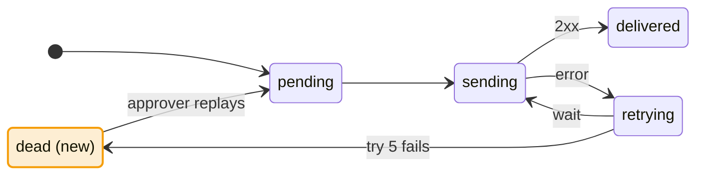

# Writing for decisions

The user's attention is the slowest step of every workflow that waits on them. Write each decision so that they can make it in seconds. Ask only what needs them, put your recommendation first, draw what has a shape, and let one word answer the whole round.

This skill covers text that a person reads to decide or approve something. Text that an agent works from (an agent brief, a skill, a ticket body) keeps its own style.

## Ask less

- **Facts are yours.** Look them up before you ask. Show each one as a `Checked:` line on the card it supports. A question asks for a choice or a trade-off.
- **Rate the undo cost** of every decision. **One-way** (hard to undo): stored data shapes, public interfaces, deleted data, sent messages, money, anything the user's own users see. **Two-way** (easy to undo): everything else.
- **Ask every one-way decision.** Ask a two-way decision only when you are not sure of the answer. Decide the two-way decisions you are sure of yourself, and list them under **Decided for you** so that the user can reopen any of them.
- **When your workflow says that the agent settles nothing**, decide nothing alone. Title the list **Settled by your `ok`** instead, and keep each item open until the reply settles it.

## The round

A **round** is one message of questions. Write it in this order:

1. **Header.** `Round <k> · <topic>`, then `<n> settled · <n> to answer now · <n> wait on these`. Name things by their title, with the id or link inside the name.
2. **Decision map**, when the round has three or more decisions, or a decision waits on another. Draw the decision tree as a flowchart. Use `done` for settled decisions, `now` for this round's, and `wait` for blocked ones (see [Diagrams](#diagrams)).
3. **Summary table**: `| # | Decision | Recommend | Undo |`. One row for each question, with one-way questions first. A user who agrees with the table can answer from it alone.
4. **Cards**, one for each question, in the order of the table.
5. **Decided for you** (or **Settled by your `ok`**): numbered `D1`, `D2`, and so on, one line each.
6. **Reply line**: `Reply: ok takes every recommendation · 2B changes one · 2? asks for more.`

A **card**:

````markdown
**Q2 · Where does a delivery go after the last failed try?** · hard to undo

**Recommend A.** Move it to a new state, `dead`. An approver can replay it.



| | Option | Result |
|---|---|---|
| A | Keep it as `dead` | You can replay it. Adds a state and a cleanup job. |
| B | Delete it | No new state. The event is lost. |

Why A: two consumers bill on this event. A lost event is lost money.
Checked: `billing` and `ledger` listen to `invoice.paid`.
````

- The question is one sentence of 20 words or fewer.
- The recommendation comes first, in two sentences or fewer.
- The options are rows labelled A, B, C. Each result says what the user will see or get: a number, an output, a data shape.
- One `Why` line, and a `Checked:` line for each fact.
- A card has 12 lines or fewer, plus its diagram. A card that needs more holds two decisions: split it.
- A two-way card can replace the table with one line for each option.

## Reading the reply

| Reply | Meaning |
|---|---|
| `ok` | Every question that the reply does not name takes its recommendation. |
| `2B` | Q2 takes option B. |
| `2: <words>` | Q2 takes the user's own answer. |
| `2?` | Q2 stays open. Explain it again, shorter or with a diagram. |
| `reopen D1` | D1 becomes a question in the next round. |

The parts combine: `ok 2B`, `1A 2?`. In a reply without `ok`, a question that the reply does not name stays open for the next round. The user can always answer in their own words.

## Summaries to approve

A summary that the user approves (a spec's owner section, a triage digest, a ticket breakdown, a plan) uses the same parts. Write a header line, the decisions as a summary table, a diagram where they have a shape, and a reply line with the workflow's own replies (for example `/approve` or `/changes <what>`).

## Plain English

Write in Simplified Technical English (ASD-STE100), but without its approved-word dictionary:

- Put one idea in each sentence. Questions and instructions have 20 words or fewer. Descriptions have 25 words or fewer.
- Write three sentences or fewer in a paragraph. After that, use a list or a table.
- Use the active voice, the present tense, and commands for actions.
- Use one word for one meaning: the glossary term (`GLOSSARY.md`, or the one `GLOSSARY-MAP.md` points to), every time. Define a term the glossary does not have in the sentence that first uses it.
- Use literal words. When you are not sure, say so in one plain clause: "I am not sure: X or Y."
- Put three nouns in a row at most: "the retry policy for webhooks", not "the webhook delivery retry policy".
- Keep "the" and "a".
- Put a risk first, with its reason.

## Diagrams

Draw a diagram when the decision has a shape. A choice without a shape gets the options table only.

| The decision is about… | Draw | Mermaid |
|---|---|---|
| How a thing changes state | State machine | `stateDiagram-v2` |
| Steps, who does what, in what order | Flow or sequence | `flowchart`, `sequenceDiagram` |
| What data we keep and how it links | Data model | `erDiagram` |
| What blocks what (tickets, a map, a decision tree) | Dependency graph | `flowchart LR` |
| Moving or merging code | Before and after, with the same node names | two `flowchart`s |
| A choice between options | Options table | none |
| A number, a name, yes or no | Nothing | none |

- **Highlight what the decision changes** with these classes. Leave the other nodes plain.

  ```
  classDef done fill:#16a34a26,stroke:#16a34a
  classDef now fill:#2563eb26,stroke:#3b82f6,stroke-width:2px
  classDef wait stroke:#9ca3af,stroke-dasharray:4 3
  classDef changed fill:#f59e0b2e,stroke:#f59e0b,stroke-width:2px
  classDef removed stroke:#ef4444,stroke-dasharray:4 3
  ```

  The label says it too: `dead (new)`, `cache (removed)`. A terminal shows the source, and not every reader sees colour.
- **Keep it small**: ten nodes or fewer, and labels of five words or fewer. Split a bigger picture into two diagrams.
- **Keep it portable.** Put it in a `mermaid` code fence: GitHub and T3 draw it, and a terminal shows source you can still read. Use `<br/>` for a line break and no other HTML. Keep labels plain text (no `**`). Leave out `%%{init}%%`, theme settings and `click`.

## A new version

When you show a revision (a spec v2, a changed breakdown, a round asked again), start with what changed since the version the user saw. Use a short list, or the diagram with the changed parts highlighted. The user reads again only what changed.

## Before you send

Done when every item is true:

- Every question has a recommendation and an undo rating, and asks for a choice, not a fact.
- The summary table matches the cards, with one-way questions first.
- No sentence has more than 25 words. No card has more than 12 lines plus its diagram.
- Each diagram belongs to a decision with a shape, and its changes are highlighted and labelled.
- The message ends with the reply line.
