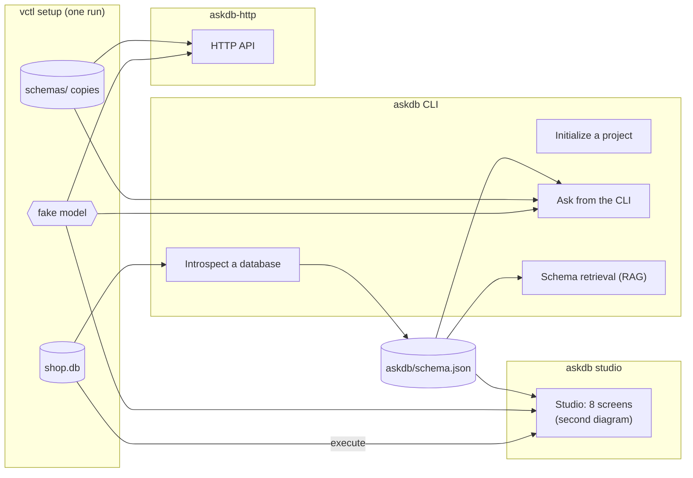
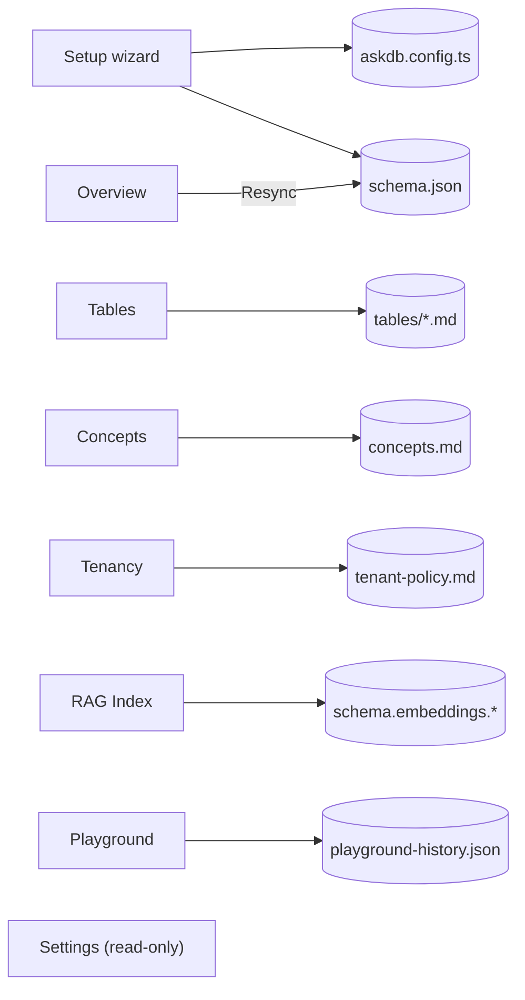

# AskDB verification map

This directory is the maintained source for verifying AskDB's user-facing behavior. Read this index before driving AskDB, then use the matching feature file as the recipe. `vctl` means `node e2e/harness/control-askdb.mjs`, run from the repo root. Each sub-feature ends `Scripted: <replay>` when a replay in `e2e/` asserts it on every PR, or `Agent-driven.` when only an agent verifies it.

## Baseline preconditions

- The CLI, HTTP API and Studio are built from this checkout: `pnpm exec turbo run build --filter=@askdb/e2e^...` (`pnpm e2e` builds them too).
- `vctl setup` has printed `run <id> ready`, and `vctl doctor` prints no `FAIL`.
- The run's project holds `shop.db` (customers `Ada`, `Grace`, `Linus`, `Margaret`; products; orders), `schemas/orders-users-sensitive.schema` (sensitive column `users.secret_recovery_token`) and `schemas/agency-multi-tenant.schema` (tenant policy over agencies, sub-agencies and clients).
- Its config points at the fake model, introspects `./shop.db` into `./askdb`, uses the mock embedder with a file store, and turns Studio execute on for `./shop.db`.
- Drive only the processes this run started (`vctl doctor` lists them).

## Driving conventions

- Start each recipe from the baseline unless its preconditions say otherwise.
- Set the model's answer with `vctl model reply "<sql>"` before each drive that generates SQL. Set it again for the next drive: the reply stays until you change it.
- Treat every command as literal: keep quoted questions, flags and SQL unchanged.
- Label each drive with the feature ID: `vctl cli --label <feature-id> -- …`.
- Prefer roles and accessible names in Studio's UI over CSS selectors or position.

## Proof and skip reporting

- CLI proof is the evidence record: command, exit code, stdout, stderr.
- HTTP proof is the evidence record: request, status, response body.
- Generation proof also includes `vctl model requests` (an `NN-<label>.jsonl` file, one request per line), showing the question and schema reached the model.
- A drive that changes files includes a second, read-only view of them (`ls`, or reading the file in the project).
- UI proof is a screenshot and an accessibility snapshot, saved to the evidence folder, with Studio's URL visible.
- Name the model each proof used: fake, or live with its model name.
- Report an unreachable entry point with the command you tried and the missing precondition. Never report it as verified through another path.

## Feature entry contract

Each feature file starts with an H1 title and one paragraph describing the user-visible behavior, then exactly four H2 sections in this order:

1. `Sub-features` lists short IDs with one line for each behavior, ending `Scripted: <replay path>` (one or more paths, joined by `and`) or `Agent-driven.` A replay runs the same steps as the `Driving` section and names its tests by these IDs: a test's name starts with every ID it replays, joined by `,` or `and`, then `:` and what it shows. A test that pins a known bug takes the ID of the sub-feature the bug belongs to and says `known bug` after the colon; it gets no ID of its own. `node e2e/harness/check-feature-map.mjs` checks this contract both ways, and `pnpm e2e` runs it first.
2. `How to get to it (user POV)` lists every user entry point.
3. `Driving it with control-askdb` starts with `Preconditions:`, then labeled bullets that pair each user action with an exact command and the observable result.
4. `Gotchas` lists traps that waste or invalidate a run.

Keep implementation details out of the map: name only user paths, stable handles, required state, commands and observable proof.

## Features

Each feature sits under the surface a user reaches it through. An arrow means the feature at its head needs what the arrow starts from before it can run.

Studio's screens, and the files in the schema folder each one writes. The setup wizard runs first when there is no schema folder, and writes the config and `schema.json` itself.

- [Ask from the CLI](./ask-cli.md) covers `askdb ask`: generated SQL, the read-only refusal, the sensitive-column warning, `--explain` and `--mock-sql`.
- [Introspect a database](./introspect.md) covers `askdb introspect` on SQLite: writing a schema folder, `--print` and `--diff`.
- [HTTP API](./http-api.md) covers `askdb-http`: `/health`, `POST /ask`, its error shape and the execute refusal.
- [Studio Overview](./studio-overview.md) covers the landing screen's cards, pending tables, shortcuts and `Resync schema`.
- [Studio Tables](./studio-tables.md) covers the table list, enrichment and its model drafts, the Schema tab and the Sensitivity tab.
- [Studio Concepts](./studio-concepts.md) covers adding a linked concept and saving `concepts.md`.
- [Studio Tenancy](./studio-tenancy.md) covers drafting a tenant policy by hand or with the model, reviewing it and saving `tenant-policy.md`.
- [Studio RAG Index](./studio-rag-index.md) covers the index status, `Build Index` and the query debugger.
- [Studio Playground](./studio-playground.md) covers generating and executing SQL in Studio, through the UI and through its API.
- [Studio Settings](./studio-settings.md) covers the read-only workspace, RAG store and schema warnings.
- [Studio setup wizard](./studio-setup-wizard.md) covers Studio's first run: writing the config, then introspecting from the browser.
- [Initialize a project](./init.md) covers `askdb init` writing a config and `.env.example` non-interactively.
- [Schema retrieval (RAG)](./rag.md) covers `askdb rag index` and `askdb rag query` with the mock embedder.

Not mapped yet: `askdb bundle`; `askdb introspect` on Postgres, MySQL and SQL Server (they need the multi-engine fixture, `pnpm fixture:up`; see the consumer-lab skill's guardrails before you start it).
