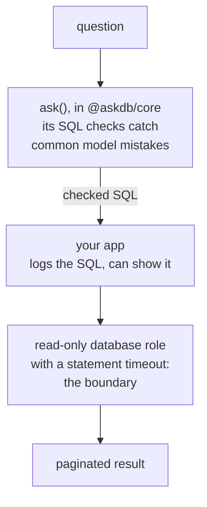

import { Aside } from "@astrojs/starlight/components";

SQL checks

AskDB checks every SQL string the model returns before handing it back to your application. The checks are heuristics that catch common model mistakes. They are defense in depth, not a security boundary. The database role your application uses to run the SQL is the boundary.

<Aside type="caution" title="Generated SQL is untrusted input">
AskDB does not parse SQL. Its checks are token- and pattern-based and can be bypassed by unusual or adversarial SQL. Before you execute anything AskDB returns, follow [Run generated SQL safely](#run-generated-sql-safely) below.
</Aside>

## What AskDB checks

Before `ask()` returns, it runs up to three checks on the model's SQL. [SQL checks reference](/reference/sql-checks/) gives each one's rules, and how it reads SQL on each engine.

- **The read-only check** makes sure the SQL is one query that reads: it starts with `SELECT` or `WITH`, holds one statement and no comments, and has no write, DDL, locking or side-effecting keyword or function. It runs for a built-in dialect or a `DialectSpec`, and always refuses what it catches. A custom `AskDialect` skips it.
- **The tenant check** runs when your schema has a tenant policy and the scope isn't `global`, under every dialect. It makes sure each tenant-scoped table the SQL reads is filtered by its tenant placeholder, and refuses or reports SQL that isn't, as your policy's `enforcement` says. See [What the tenant check requires](/reference/tenant-policy/#what-the-tenant-check-requires). Since 1.0.0-beta.50 it reads a `$` in a name, a table named after a keyword, and where a comment ends the way each engine does ([GHSA-8pwj-6hfv-5pm4](https://github.com/Ygilany/AskDB/security/advisories/GHSA-8pwj-6hfv-5pm4)), and since 1.0.0-beta.51 it reads a dollar-quoted string's tag the way Postgres does ([GHSA-rmjw-pffc-5hjr](https://github.com/Ygilany/AskDB/security/advisories/GHSA-rmjw-pffc-5hjr)).
- **The sensitive check** runs when your schema marks tables or columns `sensitive`. It reports the SQL that reads one, or refuses it in `"strict"` mode.

The checks split SQL into tokens and skip strings, quoted names and comments, so a keyword inside one doesn't count. They read backslashes in strings under each engine's default setting, and a MySQL-family `DialectSpec` with `backslashEscapes` unset reads as escapes on, the server default. If your server reads strings differently, set the dialect to match: see [Match your server's string settings](/guides/match-server-string-settings/). Rebinding a stored query with `bindPreparedQuery()` runs all three checks again, under the schema and scope you pass then.

### What these checks don't do

- **No SQL parsing.** AskDB splits SQL into tokens but doesn't build a syntax tree, so it can't tell whether the SQL is valid for your engine. Your database reports syntax errors when you run the query.
- **No guarantee they read SQL as your engine does.** Where a check reads a string, a name or a comment differently from the engine, SQL can pass that the engine runs differently. Each mismatch found is a bug, fixed and published, such as [GHSA-8pwj-6hfv-5pm4](https://github.com/Ygilany/AskDB/security/advisories/GHSA-8pwj-6hfv-5pm4) in 1.0.0-beta.50 and [GHSA-rmjw-pffc-5hjr](https://github.com/Ygilany/AskDB/security/advisories/GHSA-rmjw-pffc-5hjr) in 1.0.0-beta.51. Plan for ones not found yet.
- **No system-schema filtering.** Queries against `pg_catalog`, `information_schema`, MySQL's `mysql` schema, SQL Server's `sys`, and so on are not rejected. What they return depends on your database's privileges, and on Postgres every role can read the catalog metadata (see [System catalogs](/guides/run-safely-in-prod/#system-catalogs)).
- **No query rewriting.** AskDB never adds a tenant filter, a row limit, or a timeout to the SQL. The only change it makes to the tenant predicate is binding: it replaces the `:tenant_*_ids` placeholders the model wrote with your scope's IDs (escaped literals or driver parameter markers), and with several IDs it turns `=` into `IN (…)` and `!=` or `<>` into `NOT IN (…)`.
- **No complete side-effect analysis.** The function denylist covers known built-in functions only. A call to one of your own functions that writes and a very expensive join both pass.
- **No control over the locks a plain read takes.** Like the other checks, the locking-read check is defense in depth: it looks for locking words, not at the locks a statement takes. Your connection's isolation level still decides what a plain `SELECT` locks. On SQL Server, `REPEATABLE READ` and `SERIALIZABLE` hold shared locks on what a `SELECT` read until the transaction ends, and on MySQL and MariaDB, `SERIALIZABLE` reads every plain `SELECT` in a transaction as `FOR SHARE`. Run generated SQL in a short transaction with a lock timeout.
- **No complete tenant or sensitive coverage.** The tenant check doesn't check that joined scoped tables share a scope, and it checks a root reached through the hierarchy as a root only when the scope names it. The sensitive check can miss a table in some `FROM` forms, so a wildcard over it goes unreported. [SQL checks reference](/reference/sql-checks/) lists the known cases.

A way past the checks is a bug, and we fix it. Still, plan for the checks to miss things.

## Run generated SQL safely

AskDB returns SQL. It does not run it. If your application executes that SQL, these controls are the actual boundary, and [Run safely in production](/guides/run-safely-in-prod/) sets each one up:

- **A least-privilege, read-only database role.** Grant `SELECT` only on the tables AskDB is meant to query, leave out sensitive tables you can exclude, and make the role's transactions read-only. Then a query that gets past AskDB's checks still can't write, and can't read rows the role can't see. On Postgres every role can still read the catalog's table and column names through `PUBLIC`.
- **Tenancy enforced in the database.** For multi-tenant data, make the database the tenant boundary: row-level security keyed on a per-request setting, per-tenant views, or per-tenant roles. AskDB doesn't know who's asking: your application decides which tenant IDs go into `tenantScope`. See [Enforce tenancy in the database](/guides/enforce-tenancy-in-the-database/).
- **Timeouts and row limits.** Set a statement timeout and a lock timeout on the connection. The SQL `ask()` returns has no row limit, so cap the rows you read (see [Row limits](/guides/run-safely-in-prod/#row-limits)).
- **Untrusted prompt inputs.** The question text, the schema itself (a schema directory, a bundle, or a per-request `schemaJson`), and your schema enrichment (descriptions, concepts, tenant-policy prose) all go into the prompt. Someone who controls any of them can try to steer the model toward a different query, so load schema only from sources you trust.
- **Review and audit.** For high-stakes questions, show the SQL to a person before running it, and log every question, generated SQL string, and outcome.

## Defense in depth

AskDB's checks and your execution boundary are separate layers. AskDB's checks catch the common ways a model gets it wrong: a write statement, a stacked second statement, a forgotten tenant filter, a sensitive column. The database role, RLS policies, and timeouts in your runtime hold even when a query gets past those checks.

A typical production stack looks like:

<figure>

<figcaption>AskDB's checks catch common model mistakes. The read-only role, the statement timeout and pagination in your runtime hold when a query gets past them.</figcaption>
</figure>

Each layer does one job, and no single layer is the only protection.

## Read next

  <a href="/reference/sql-checks/"><strong>SQL checks reference</strong>Each check's rules, and how it reads SQL on each engine.</a>
  <a href="/guides/run-safely-in-prod/"><strong>Run safely in production</strong>The full operator checklist for the execution side.</a>
  <a href="/guides/enforce-tenancy-in-the-database/"><strong>Enforce tenancy in the database</strong>Row-level security, so the generated SQL can't change its own tenant.</a>

