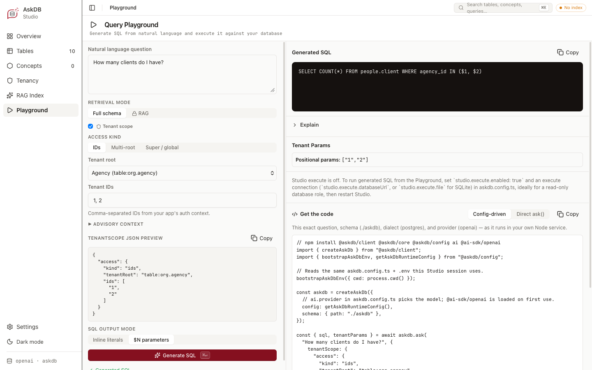

<p class="doc-eyebrow">Tenant-scoped generation</p>

<p class="doc-lede">In a multi-tenant schema, each user should see only their own tenants' rows. Declare how your schema represents tenancy in a tenant policy, and pass the caller's tenant scope on each call. AskDB then has the model filter every scoped table by tenant, checks that the filter is there, and binds your tenant IDs. Keep the database as the tenant boundary: see <a href="/concepts/tenant-isolation/">Tenant isolation</a>.</p>

## Before you start

- **A schema artifact and a service that calls `ask()`.** [Embed in a Node app](/guides/embed-in-node/) sets one up.
- **Your application knows which tenants each user may see.** AskDB binds the scope you pass, but never decides it, so authorizing it stays your job.

## 1. Write the tenant policy

The recommended path is Studio's **Tenancy** view, which guides you through declaring tenant roots, scoped tables, and global tables in a form. Studio can also draft a policy with AI from your schema's tables, keys and foreign keys, for your review.

You can also write `tenant-policy.md` in the schema artifact by hand. Every table or column reference uses the stable IDs from `schema.json`. Example for a simple SaaS schema:

```yaml
---
schemaId: my-app
enforcement: strict

roots:
  - id: table:public.organizations
    tenantIdColumn: table:public.organizations#id
    label: Organization

scopedTables:
  - id: table:public.projects
    scopeThrough:
      - root: table:public.organizations
        column: table:public.projects#organization_id
  - id: table:public.documents
    scopeThrough:
      - root: table:public.organizations
        column: table:public.documents#organization_id

globalTables:
  - table:public.plan_tiers
  - table:public.countries
---

# Tenant Policy

Organizations are the only tenant level. Projects and documents carry a
direct `organization_id`; plan tiers and countries are shared lookups.
```

Classify every table: a table in none of `scopedTables`, `polymorphicTables` or `globalTables` is **unknown**, and a query that names it triggers a warning, and in `strict` mode an error. Start with `enforcement: strict`. [Field reference](/reference/tenant-policy/#field-reference) lists every field.

`loadSchema()` checks the policy against `schema.json` when it loads the artifact. Under `strict`, a policy that names IDs `schema.json` doesn't have doesn't load: see [When the policy and the schema disagree](/reference/tenant-policy/#when-the-policy-and-the-schema-disagree).

## 2. Pass the caller's tenant scope

With a policy in place, every `ask()` call needs a `tenantScope`. Build it from the IDs your application authorized for this user:

```ts
// askdb initialized at startup with createAskDb() — see Embed in a Node app.
const tenantScope = {
  access: {
    kind: "ids",
    tenantRoot: "table:public.organizations",
    ids: ["org_abc123"],
  },
} as const;

// tenantSqlMode defaults to "sql-params": the tenant IDs come back as driver parameters.
const result = await askdb.ask("How many documents did we create this month?", {
  tenantScope,
});
```

`access.kind` picks the scope's shape:

- **`ids`:** exact tenant IDs on one root, the common case.
- **`multi_root`:** IDs across several roots, each with its own list.
- **`subtree`:** a root's IDs and everything beneath them. See [Scope to a tenant hierarchy](/guides/tenant-hierarchy/).
- **`global`:** deliberately unscoped, with a `reason` for the audit trail. The tenant check is skipped, and SQL that still uses a tenant placeholder throws `TenantScopeError`.

The optional `context`, such as a role or a department, goes into the prompt as advisory text, and nothing enforces it. Polymorphic tables are declared in the policy and surfaced to the model through the prompt; there's no scope field for pre-resolving them at runtime. [`TenantScope`](/reference/core-api/#tenantscope) lists every field.

## 3. Run the SQL

In the default `tenantSqlMode`, `"sql-params"`, the tenant IDs come back as driver parameters. Run one of the two pairs:

```ts
// Two executable pairs — pick one, never concatenate the arrays.
if (result.unboundSql && result.params) {
  // Every value bound; params already includes the tenant IDs.
  await pool.query(result.unboundSql, result.params);
} else {
  // Business values inlined; tenant markers start at $1.
  await pool.query(result.sql, result.tenantParams);
}
```

For a question like "how many documents this month?", the model writes the tenant predicate with a placeholder, and AskDB binds your IDs into it. Without the policy, the SQL might be:

```sql
SELECT COUNT(*) FROM documents WHERE created_at >= NOW() - INTERVAL '1 month';
```

With the policy and an `ids` scope for `org_abc123`, in the default mode:

```sql
SELECT COUNT(*) FROM documents
WHERE organization_id = $1 AND created_at >= NOW() - INTERVAL '1 month';
```

To get one SQL string with the IDs inlined instead, set `tenantSqlMode: "sql-only"`: see [SQL output modes](/reference/tenant-policy/#sql-output-modes). To rerun a query for the same caller with a new value, see [Rerun a query with new values](/guides/rerun-a-query-with-new-values/).

## 4. Try it in Studio's Playground



With a tenant policy, the Playground's **Tenant scope** box is ticked. Choose the access kind (**IDs**, **Multi-root** or **Super / global**), then the tenant root and its IDs, or the reason for a global scope. **Advisory context** adds the scope's `context`, and the **tenantScope JSON preview** shows the scope Studio passes. **SQL output mode** switches between **$N parameters**, the default, and **Inline literals**. **Generate SQL** shows the SQL with its tenant parameters.

## 5. Enforce it in the database

AskDB's tenant check is a heuristic over the SQL's tokens, so a query can get past it. Make the database the tenant boundary: [Enforce tenancy in the database](/guides/enforce-tenancy-in-the-database/) sets up Postgres row-level security, and [Tenant isolation](/concepts/tenant-isolation/) explains why.

## If it fails

| Error | Fix |
| --- | --- |
| `TenantScopeError` `MISSING_SCOPE` | Pass a `tenantScope` on every call. A schema with a policy needs one. |
| `TenantScopeError` `GLOBAL_WITHOUT_REASON` | Give the `global` scope a non-blank `reason`. |
| `TenantScopeError` `UNRESOLVED_TENANT_PLACEHOLDER` | The SQL uses a tenant placeholder the scope has no IDs for, such as any placeholder under a `global` scope. Pass a scope that covers that root. |
| `TenantGuardrailError` | The SQL fails the tenant check. [What the tenant check requires](/reference/tenant-policy/#what-the-tenant-check-requires) lists each rule. |
| `SchemaParseError` naming `tenant-policy.md` | The policy has a key AskDB doesn't know, or, under `strict`, names IDs `schema.json` doesn't have. See [When the policy and the schema disagree](/reference/tenant-policy/#when-the-policy-and-the-schema-disagree). |

[`TenantScopeError` reasons](/reference/core-api/#tenantscopeerror-reasons) lists the rest.

## Read next

<div class="home-path-grid">
  <a href="/guides/enforce-tenancy-in-the-database/"><strong>Enforce tenancy in the database</strong><span>Make Postgres row-level security the tenant boundary for generated SQL.</span></a>
  <a href="/guides/tenant-hierarchy/"><strong>Scope to a tenant hierarchy</strong><span>Let a user see a tenant and everything beneath it.</span></a>
  <a href="/reference/tenant-policy/"><strong>Tenant policy format</strong><span>Every policy field, and what the tenant check requires.</span></a>
  <a href="/concepts/tenant-isolation/"><strong>Tenant isolation</strong><span>What the policy and the check do, and why the database stays the boundary.</span></a>
</div>
