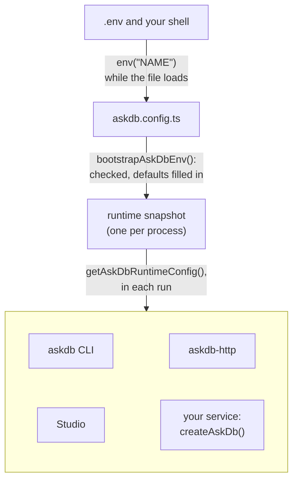

import InstallTabs from "../../../components/InstallTabs.astro";

<p class="doc-eyebrow">Reference · @askdb/config</p>

<p class="doc-lede"><code>@askdb/config</code> loads <code>.env</code> and <code>askdb.config.*</code>, checks the config, and keeps the result as one snapshot for the process. The CLI, Studio and the HTTP API read their settings from it, and so does <code>createAskDb()</code> in your own service. The keys you can set are in the <a href="/reference/config/">Configuration reference</a>.</p>

<InstallTabs pkgs="@askdb/config" />

<figure>



<figcaption><code>env()</code> reads the environment only while the config file loads. <code>bootstrapAskDbEnv()</code> checks the result and installs it as the process's snapshot, and each surface reads the snapshot with <code>getAskDbRuntimeConfig()</code>. Other than <code>ASKDB_DEBUG</code>, an <code>ASKDB_*</code> variable set in the shell reaches a run only through an <code>env()</code> call in the config.</figcaption>
</figure>

## Write a config

### `defineConfig(config)`

Takes an `AskDbConfig`, the object you write in `askdb.config.ts`, and returns the `AskDbEnvProjection` the file exports. It checks the config the way loading does, so a config that can't load throws an `askdb.config:` error, such as `askdb.config: modes.omitSensitiveFromPrompt must be a boolean (got "false").`

```ts
import { defineConfig, env } from "@askdb/config";

export default defineConfig({
  ai: { provider: "openai", providerConfig: { openai: { apiKey: env("OPENAI_API_KEY") } } },
  introspection: { provider: "postgres", providerConfig: { postgres: { databaseUrl: env("DATABASE_URL") } } },
});
```

A plain `export default { … }` loads too: the loader runs it through `defineConfig`, so both forms get the same checks.

### `env(name)` and `requiredEnv(name)`

Both read `process.env[name]` and trim it. Call them in the config file, where they run once, when the file loads.

- **`env(name)`** returns `undefined` when the variable is missing or blank, so the field takes its default.
- **`requiredEnv(name)`** throws when the variable is missing or blank: `Missing required environment variable "<name>". Set it in your .env file (or your shell environment) before using this code path.` Every command loads the whole config, so the variable must be set even for a command that doesn't use the field.

## Load it

### `bootstrapAskDbEnv(options?)`

```ts
import { bootstrapAskDbEnv } from "@askdb/config";

const { dotenvPath, configPath } = bootstrapAskDbEnv({ cwd: process.cwd() });
```

It runs these steps, once per call:

1. Loads a `.env` file into `process.env` with `dotenv`. A variable already set in the environment keeps its value.
2. Finds the config file in `cwd` (see [File discovery](#file-discovery)) and loads it synchronously.
3. Checks the config and installs the result as the process's snapshot, replacing any earlier one.
4. Reports each deprecated key the config uses as a `DeprecationWarning` with the code `ASKDB_CONFIG_DEPRECATED`, once per process.

It doesn't copy settings into `process.env`.

The `askdb` CLI and Studio call it in the directory they start in, and `createAskDbHttpServer()` calls it when nothing has yet. In your own service, call it once at startup, before `createAskDb()`.

Options, `BootstrapAskDbEnvOptions`:

| Field | Type | Default | Description |
| --- | --- | --- | --- |
| `cwd` | `string` | `process.cwd()` | Where to look for the config file and the default `.env`. |
| `dotenvCandidatePaths` | `readonly string[]` | none | `.env` files to try in order. The first one that exists and loads wins; one that fails to load is skipped without a report. When none loads, the `.env` in the process's working directory is tried. Without this option, only `<cwd>/.env` is read. |
| `dotenvNonFatal` | `boolean` | `true` | What a `.env` that exists but can't be read does, such as a directory named `.env`. With `true`, `Failed to load .env: <reason>` goes to stderr, `process.exitCode` becomes `1`, and loading goes on. With `false`, it throws that error. A missing `.env` is never an error. |

It returns `{ dotenvPath, configPath }`. `dotenvPath` is the `.env` file it loaded: the first candidate that loaded, or `<cwd>/.env` when you pass no candidates. It's absent when none loaded, and also when the fallback `.env` after the candidates did. `configPath` is the config file.

It throws:

- `No askdb.config.* or .config/askdb.* found under <cwd>. Create one with `askdb init` or add defineConfig({ ... }) at the project root.` when there's no config file.
- `AskDB config at <path>: <reason>` when the config can't load, such as `AskDB config at /app/askdb.config.ts: modes.omitSensitiveFromPrompt must be a boolean (got "false").` That includes a file that uses top-level `await`, and a default export that is a `Promise`.
- `Failed to load .env: <reason>`, with `dotenvNonFatal: false`.

### File discovery

`bootstrapAskDbEnv()` looks in `cwd` only, not in parent directories, in this order:

1. `askdb.config.<ext>`
2. `.config/askdb.<ext>`

Each location tries the extensions in this order: `ts`, `mts`, `cts`, `js`, `mjs`, `cjs`. The first file found wins, so any `askdb.config.*` comes before `.config/askdb.*`. JSON config files aren't supported. Every extension loads synchronously, `.mjs` included, so the file can't use top-level `await`. A JavaScript config (`js`, `mjs`, `cjs`) loads with Node's own loader, by Node's rules: `.js` is CommonJS or an ES module according to the nearest `package.json`. A TypeScript config (`ts`, `mts`, `cts`) loads with jiti, which compiles it, so only a JavaScript config loads from inside an app's bundle ([Bundle an app that uses AskDB](/guides/bundle-your-app/)).

`discoverAskDbConfigPath(cwd)` returns the path this finds, or `undefined`. Its extension's type is `AskDbConfigExtension`.

### `loadAskDbConfigProjection(cwd)` and `loadAskDbConfigProjectionSync(cwd)`

Load and check the config file in `cwd`, without reading `.env` or installing a snapshot. They return `{ path, projection }`, or `{}` when `cwd` has no config file; the first one returns it in a `Promise`. `projection` is an `AskDbEnvProjection`: `config`, the config as written; `deprecations`, one message per deprecated key it uses; and `entries` (see [Internal](#internal)). They throw the same `AskDB config at <path>:` errors as `bootstrapAskDbEnv()`.

## Read it

### `getAskDbRuntimeConfig()`

Returns the snapshot as an `AskDbRuntimeConfig`: every setting checked, with its default filled in. Before any snapshot is installed, it throws `AskDB runtime is not initialized. Call bootstrapAskDbEnv() from @askdb/config after startup, typically with the project cwd, and ensure askdb.config.* exists.`

```ts
import { bootstrapAskDbEnv, getAskDbRuntimeConfig } from "@askdb/config";

bootstrapAskDbEnv({ cwd: process.cwd() });

const rt = getAskDbRuntimeConfig();
const language = rt.ai.language;              // { provider, connection, model, modelFamily, reasoning }
const embedding = rt.ai.embedding;            // { provider, connection, model, dimensions } when rag.embedder is "ai"
const store = rt.rag.store;                   // "file" | "memory" | "pgvector"; "memory" when the config has no rag block
const outputDir = rt.introspection.outputDir; // the schema artifact directory, "./askdb/" by default
```

| Field | Type | Holds |
| --- | --- | --- |
| `structured` | `AskDbConfig` | The config as written. The `host` block has no section of its own: hosts read `structured.host`. |
| `ai.language` | `AskDbRuntimeAiSection` | The language model's `provider`, its `connection` and its `model`, plus `modelFamily` and `reasoning`. `model` is `undefined` only for a custom provider with no model set. |
| `ai.embedding` | `AskDbRuntimeAiSection` or `undefined` | The embedding model's `provider`, `connection`, `model` and `dimensions`. `undefined` unless `rag.embedder` is `"ai"`. |
| `introspection` | `AskDbRuntimeIntrospectionConfig` | `provider`; the connection for that provider (`postgresDatabaseUrl`, `mysqlDatabaseUrl`, `sqlserverDatabaseUrl`, `sqliteFile` or `prismaSchemaPath`, the others `undefined`); `schemas`; and `outputDir`. |
| `rag` | `AskDbRuntimeRagConfig` | `store`, `"memory"` when the config has no `rag` block, and `storeConfig` as written, `{}` without one. |
| `logging` | `AskDbRuntimeLoggingConfig` | `level` (`undefined` leaves it to each tool), `correlationId`, `logFile` and `logStdout`. |
| `httpApi` | `AskDbRuntimeHttpApiConfig` | `listen.port` (`3000`), `listen.host` (`"127.0.0.1"`), `allowSchemaOverride` (`false`) and `requestTimeoutMs` (`60000`). |
| `dev` | `AskDbRuntimeDevConfig` | `mockSql`. |
| `modes` | `AskDbRuntimeModesConfig` | `askdbMode` (`undefined` means `"schema_only"`) and `omitSensitiveFromPrompt`. |
| `nlToSql` | `AskDbRuntimeNlToSqlConfig` | `dialect`: the config's `dialect`, or `undefined`. |
| `studio.execute` | `AskDbRuntimeStudioConfig` | `provider`, `databaseUrl`, `file`, `enabled`, `useIntrospectionConnection`, `timeoutMs` and `maxRows`, resolved as [Studio execute configuration](/reference/config/#studio-execute-configuration) describes. `introspectionConnectionAvailable` is `true` when the introspection config has a connection for this provider that execute didn't use. |
| `deprecations` | `readonly string[]` | One message per deprecated key the config uses. It names the old and new key, never a value. |
| `flat` | `Readonly<Record<string, string>>` | Internal: see [Internal](#internal). |

Each AI section's `connection` is an `AskDbRuntimeAiConnection`: the connection's `name` (`"default"` when unnamed) and its settings, `apiKey`, `apiKeySecondary`, `baseUrl`, `resourceName` and `apiVersion`, with unset ones left out. The config's `secondaryApiKey` is `apiKeySecondary` here, as `@askdb/ai` names it. Each section holds its own connection only. Pass a section to the `@askdb/ai` registry's `*FromSection` methods as it is:

```ts
import { createAiRegistry } from "@askdb/ai";

const ai = createAiRegistry();
const model = await ai.createLanguageModelFromSection(rt.ai.language); // undefined without an API key
const embeddingModel = rt.ai.embedding
  ? await ai.createEmbeddingModelFromSection(rt.ai.embedding) // asks for rt.ai.embedding.dimensions when it's set
  : undefined; // rag.embedder is "mock"
```

### `isAskDbRuntimeInitialized()`

Returns `true` once a snapshot is installed. Code that may run before or after its host's bootstrap can call `bootstrapAskDbEnv()` only when this is `false`, as `createAskDbHttpServer()` does.

The snapshot is process-wide. It lives on `globalThis` under a registered symbol, so when two versions of `@askdb/config` are installed, both read the one your process bootstrapped.

### `isAskDbDebugEnabled()`

Returns `true` when the `ASKDB_DEBUG` shell variable is `1` or `true`, in any case. It reads `process.env` directly, so it works when the config is missing or fails to load. The first-party binaries use it to print the stack trace of an unexpected error.

## Constants

Each provider's default `ai.language.model`, and the other defaults AskDB fills in:

| Constant | Value |
| --- | --- |
| `DEFAULT_OPENAI_LANGUAGE_MODEL` | `"gpt-4o-mini"` |
| `DEFAULT_AZURE_OPENAI_DEPLOYMENT` | `"gpt-4o-mini"` |
| `DEFAULT_ANTHROPIC_LANGUAGE_MODEL` | `"claude-sonnet-4-6"` |
| `DEFAULT_GOOGLE_LANGUAGE_MODEL` | `"gemini-2.0-flash"` |
| `DEFAULT_GATEWAY_LANGUAGE_MODEL` | `"openai/gpt-4o-mini"` |
| `DEFAULT_INTROSPECT_OUTPUT_DIR` | `"./askdb/"` |

The values each enum-like field accepts, as a constant list and its type:

| Constant | Type | Values |
| --- | --- | --- |
| `ASKDB_MODES_V1` | `AskDbModeV1` | `"schema_only"`, `"bounded_results"` |
| `ASKDB_LOG_LEVELS` | `AskDbLogLevel` | `"fatal"`, `"error"`, `"warn"`, `"info"`, `"debug"`, `"trace"`, `"silent"` |
| `ASKDB_RAG_EMBEDDERS` | `AskDbRagEmbedder` | `"mock"`, `"ai"` |
| `ASKDB_RAG_STORES` | `AskDbRagStore` | `"file"`, `"memory"`, `"pgvector"` |
| `ASKDB_AI_PROVIDERS` | `AskDbAiProviderId` | `"openai"`, `"azure"`, `"foundry"`, `"anthropic"`, `"google"`, `"gateway"`: the providers with their own `ai.providerConfig` branch |
| `ASKDB_INTROSPECTION_PROVIDERS` | `AskDbIntrospectionProvider` | `"postgres"`, `"prisma"`, `"mysql"`, `"sqlite"`, `"sqlserver"` |
| `ASKDB_DIALECTS` | `AskDbDialectId` | `"postgres"`, `"cockroachdb"`, `"mysql"`, `"mariadb"`, `"sqlite"`, `"sqlserver"` |
| `ASKDB_STUDIO_EXECUTE_PROVIDERS` | `AskDbStudioExecuteProvider` | `"postgres"`, `"mysql"`, `"sqlite"`, `"sqlserver"` |
| `ASKDB_REASONING_EFFORTS` | `AskDbReasoningEffort` | `"minimal"`, `"low"`, `"medium"`, `"high"` |

## Types

The config you write is an `AskDbConfig`. Its parts:

- **`ai`:** `AskDbAiConfig`, with `AskDbAiLanguageConfig`, `AskDbAiEmbeddingConfig` and `AskDbAiReasoningConfig` for its sections. `ai.providerConfig` is `AiProviderConnections`: each provider's value is `AiConnections<T>`, one `AiNamedConnection<T>` or a list of them, where `T` is `OpenaiConnection`, `AzureConnection`, `FoundryConnection`, `AnthropicConnection`, `GoogleConnection`, `GatewayConnection`, or `CustomConnection` for any other id.
- **`introspection`:** `AskDbIntrospectionConfig`, a union by `provider`. Its Postgres and Prisma members are exported as `PostgresIntrospectionConfig` and `PrismaIntrospectionConfig`.
- **`rag.storeConfig`:** `FileStoreConfig`, `MemoryStoreConfig` or `PgvectorStoreConfig`.

The snapshot is an `AskDbRuntimeConfig`, with the section types in the table under [`getAskDbRuntimeConfig()`](#getaskdbruntimeconfig): `AskDbRuntimeAiConfig` (with `AskDbRuntimeAiSection` and `AskDbRuntimeAiConnection`), `AskDbRuntimeIntrospectionConfig`, `AskDbRuntimeRagConfig`, `AskDbRuntimeLoggingConfig`, `AskDbRuntimeHttpApiConfig`, `AskDbRuntimeDevConfig`, `AskDbRuntimeModesConfig`, `AskDbRuntimeNlToSqlConfig` and `AskDbRuntimeStudioConfig`.

## Tests

- **`setAskDbRuntimeForTests(config)`** installs an `AskDbConfig` as `bootstrapAskDbEnv()` installs a loaded file, without reading the disk or `.env`. It throws the same `askdb.config:` errors as `defineConfig()`.
- **`resetAskDbRuntimeForTests()`** removes the snapshot, so `isAskDbRuntimeInitialized()` returns `false` again.

## The `@askdb/config/scaffold` entry point

The tooling `askdb init` and Studio's setup wizard share, for tools that set up a project. It's experimental, like Studio: a minor release of `@askdb/config` may change it ([ADR 0030](https://github.com/Ygilany/AskDB/blob/main/docs/adrs/0030-1-0-promises-checked-sql-only.md)). Your own `askdb.config.ts` never needs it.

- **`planAskDbScaffold(answers, versions)`** turns a new project's answers into its `askdb.config.ts` source, its `.env.example`, the env vars the config reads and the packages to install. It throws `AskDbScaffoldInputError`, with the answer's `field`, for a bad answer. Its types are `AskDbScaffoldAnswers` (its `ai` answer is an `AskDbAiConfigScaffoldInput`), `AskDbScaffoldPlan` and `ScaffoldValue`.
- **`isAskDbScaffoldEnvName(name)`** is its rule for an env var name: POSIX and uppercase (`^[A-Z_][A-Z0-9_]*$`).
- **The package-manager helpers:** `detectPackageManager`, `findNearestPackageJsonDir`, `isLikelyWorkspaceRoot`, `lockfilePackageManager`, `packageManagerAddArgs`, `supportedBuildApprovals`, `formatInstallCommand` and `packageManagerSpawnSpec`, with the types `PackageManager` and `PackageManagerSpawnSpec`.

## Internal

These are exported, but they serve AskDB's own packages and tools. Don't build on them.

- **`getAskDbRuntimeConfig().flat`:** a map of internal keys named like environment variables, such as `ASKDB_INTROSPECT_OUT` and `ASKDB_PGVECTOR_URL`, built from the same checked config, and the same map as a projection's `entries`. It holds no API keys. Studio reads its pgvector settings and its default schema directory from it, and it's kept for copies of `@askdb/config` that still read it. AskDB never reads these keys from the environment, so setting one in the shell changes nothing.
- **`mergeAskDbFlatIntoEnvMap(base, flat)`:** returns a copy of `base` with each non-blank entry of `flat` added, to build a child process's environment from `getAskDbRuntimeConfig().flat`. It doesn't read `process.env` itself. [ADR 0005](https://github.com/Ygilany/AskDB/blob/main/docs/adrs/0005-askdb-config-and-env-bootstrap.md) names it for tools that spawn processes.

## Read next

<div class="home-path-grid">
  <a href="/reference/config/"><strong>Configuration reference</strong><span>Every <code>askdb.config.ts</code> key, its type and its default.</span></a>
  <a href="/reference/client-api/"><strong>@askdb/client API</strong><span><code>createAskDb()</code>, which takes the snapshot as <code>config</code>.</span></a>
  <a href="/guides/bring-your-own-model/"><strong>Bring your own model</strong><span>Build a model from the config's <code>ai.language</code> section, or without a config.</span></a>
</div>
