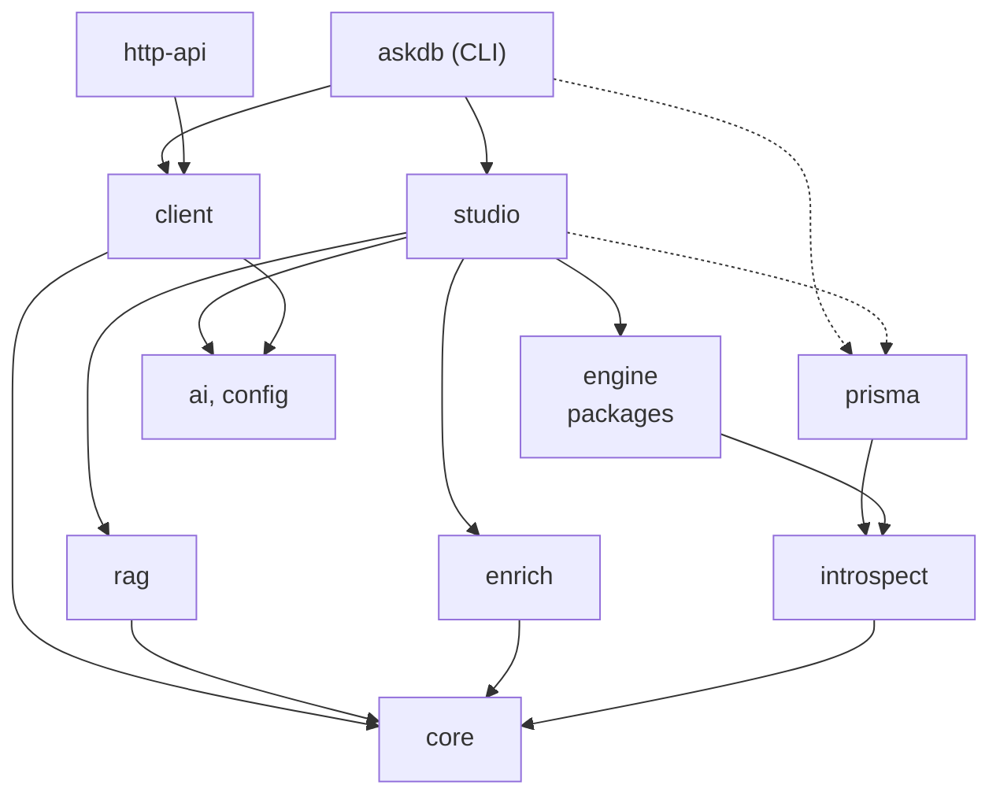

import InstallTabs from "../../../components/InstallTabs.astro";

Reference · Packages

AskDB is a workspace of focused packages. Install the ones your use case needs. This page is the index — purpose, install, and key exports for each. <a href="/reference/versioning/">Versioning and stability</a> lists which packages are on 1.0 and what each version bump means.

## Core

### `@askdb/core`

The NL-to-SQL pipeline. Schema loading, prompt construction, validation, tenant-scope handling, and the built-in dialects all live here, so `ask({ dialect: "postgres" })` needs no engine package.

<InstallTabs pkgs="@askdb/core ai" />

`ai` (the Vercel AI SDK) is a required **peer dependency** of `@askdb/core`, with the range `^6.0.0 || ^7.0.51` (AI SDK 6, or 7.0.51 and later). Your app owns its version: `ask()` receives a model your app constructs, so core uses your app's `ai` instead of bundling its own — upgrading AskDB never forces an AI SDK upgrade on the rest of your app. Build the model with an AI SDK provider package (for example `@ai-sdk/openai`), or through the config-driven path (`@askdb/ai` and `@askdb/client`), which currently requires AI SDK 7.

Every package on this page that depends on `@askdb/core` also needs `ai` installed, even if you only introspect and never generate SQL, because core loads `ai` when it is imported. The four engine packages, `@askdb/introspect`, `@askdb/prisma` and `@askdb/enrich` declare `ai` as a peer with core's range, `@askdb/client` declares it as a peer (AI SDK 7), and `@askdb/rag` as an optional peer. Under Yarn Plug'n'Play, each one passes your app's `ai` through to core. npm 7+ and pnpm install the missing peer for you. Yarn doesn't, so the install commands on this page list `ai` explicitly.

**Key exports**

| Symbol | Purpose |
| --- | --- |
| `ask(options)` | The main pipeline. Returns checked SQL. See [full API reference](/reference/core-api/). |
| `loadSchema(path)` | Load a schema artifact from a directory, bundle, or `schema.json`. |
| `saveSchemaFile(schemaDir, relativePath, content)` | Write one file inside a schema directory. Refuses a symbolic link at the file or at a directory below the schema directory, and writes through a temporary file renamed over the target. |
| `validateTenantScope` / `resolveTenantSql` | Tenant-scope validation and placeholder binding. |
| `createAskDbLogger` | Structured logger that emits AskDB log events. |
| `POSTGRES_DIALECT` and built-in dialect IDs | Dialect inputs accepted by `ask()`. |
| `AskDbLanguageModel` | AskDB's public name for the AI SDK language model contract. |
| `AskUsage` | Token usage type returned in `AskPipelineResult`. |

See the **[@askdb/core API reference](/reference/core-api/)** for the full option and return-type documentation.

### `@askdb/client`

Config-aware facade over `@askdb/core`. `createAskDb()` resolves the schema, model, and dialect from your `askdb.config.*` (with every `@askdb/ai` built-in provider registered by default), so call sites pass only a question. Install it when you want the shortest config-driven path; skip it when you construct the model and load the schema yourself and call `ask()` directly.

<InstallTabs pkgs="@askdb/client @askdb/core @askdb/config ai @ai-sdk/openai" />

**Key exports**

| Symbol | Purpose |
| --- | --- |
| `createAskDb(options)` | Build a client bound to a config. Registers every built-in AI provider by default; `providers: ["openai"]` restricts the set, adapter objects add custom providers, or pass a prebuilt `registry`. Returns an [`AskDbClient`](/reference/client-api/#askdbclient): `ask`, `bind` and `reload`. Options include `unknownDialect: "throw" \| "fallback-postgres"` for artifacts recorded by an unrecognized provider. |
| `client.ask(question, overrides?)` | Resolve schema/model/dialect and run the pipeline. Overrides: `schema`, `model`, `dialect`, plus all `ask()` options. |
| `AskDbClient` / `CreateAskDbOptions` / `AskOverrides` | Types for the client, constructor options, and per-call overrides. |
| `SchemaLoadError` / `SchemaNotConfiguredError` / `ModelNotConfiguredError` / `DialectNotSupportedError` | Typed errors for the resolution steps — catch these to map failures to your own error handling. |

See the **[@askdb/client API reference](/reference/client-api/)** for the full option documentation.

**Experimental: `@askdb/client/charts`.** A second entry point plans a chart for a query result without sending rows to the model: `classifyResult()`, `planChart()` and `validateChartSpec()`. It's outside the stability promise, so a minor release may change it. See the **[@askdb/client/charts API reference](/reference/client-charts-api/)**.

### `@askdb/ai`

The AI provider registry, with built-in providers for OpenAI, Azure OpenAI and Microsoft Foundry, Google Gemini, Anthropic and the Vercel AI Gateway. `@askdb/client` depends on it and builds the registry for you. Import it yourself to build a model object outside the client, to restrict or extend the set of providers, or to share one registry across several clients.

<InstallTabs pkgs="@askdb/ai ai" />

Each built-in provider's AI SDK package, such as `@ai-sdk/openai`, is an optional peer dependency: install the one you use. The [@askdb/ai API reference](/reference/ai-api/) lists every export, the env variables it reads without a config file, and how to write an adapter for another provider.

### `@askdb/config`

Loads `.env` and `askdb.config.*`, checks the config, and keeps it as the process's runtime snapshot, which the CLI, Studio, the HTTP API and `createAskDb()` read. It depends on no other AskDB package.

<InstallTabs pkgs="@askdb/config" />

The [@askdb/config API](/reference/config-api/) lists every export, including the experimental `@askdb/config/scaffold` entry point, and the [Configuration reference](/reference/config/) every config key.

## Engine packages

Each engine package ships the introspection connector for its engine, a catalog query runner on the engine's driver (an optional peer), and a re-export of that engine's dialect from `@askdb/core`. `ask()` needs only the dialect id, no engine package. The [Introspection API reference](/reference/introspect-api/#engine-packages) lists their exports.

### `@askdb/postgres`

<InstallTabs pkgs="@askdb/postgres ai" />

The PostgreSQL connector, for a live database or an export bundle, the catalog SQL templates, and an optional `pg`-based catalog query runner. Pass `dialect: "postgres"` to `ask()`.

### `@askdb/mysql`

<InstallTabs pkgs="@askdb/mysql ai" />

The MySQL and MariaDB connector, and an optional `mysql2`-based catalog query runner for live introspection. Pass `dialect: "mysql"` or `dialect: "mariadb"` to `ask()`.

### `@askdb/sqlite`

<InstallTabs pkgs="@askdb/sqlite ai" />

The SQLite connector, and an optional `better-sqlite3`-based catalog query runner that reads a database file. Pass `dialect: "sqlite"` to `ask()`.

### `@askdb/sqlserver`

<InstallTabs pkgs="@askdb/sqlserver ai" />

The SQL Server (T-SQL) connector, and an optional `mssql`-based catalog query runner for live introspection. Pass `dialect: "sqlserver"` to `ask()`.

## Introspection

### `@askdb/introspect`

The engine-agnostic introspection contract and the schema-directory writer. Use directly only when you're calling introspection from your own code — the CLI wraps this for you.

<InstallTabs pkgs="@askdb/introspect ai" />

Its API is in the [Introspection API reference](/reference/introspect-api/): `introspect()`, the schema writer (`renderToSchemaV2()`, `renderSchemaV2Body()`), the connector registry that config-driven hosts use to pick an engine by id, and the `@askdb/introspect/kit` helpers for writing a connector for a new engine.

### `@askdb/prisma`

File-only connector that reads `.prisma` schema files and produces AskDB physical metadata — no live database needed. It includes no dialect: pass `ask()` the dialect id that matches your database. Its API is in the [Introspection API reference](/reference/introspect-api/#askdbprisma).

<InstallTabs pkgs="@askdb/prisma @askdb/introspect ai" />

`askdb` and `@askdb/studio` list it as an optional peer and load it only for Prisma introspection, so install it next to them to introspect a Prisma schema from the CLI or Studio. It depends on Prisma, whose `@prisma/engines` build pnpm 11 must approve. See [the Prisma integration guide](/guides/integrations/prisma/#install).

## Authoring

### `@askdb/studio`

Browser-based schema-authoring UI. The CLI's `askdb studio` command lazy-imports this package. Schema browsing, enrichment, and SQL generation do not require a database driver. Resyncing from a Prisma schema needs `@askdb/prisma`, an optional peer. The Query Playground's live execute feature supports Postgres, MySQL, SQLite, and SQL Server — each requires its own optional peer driver package.

<InstallTabs pkgs="@askdb/studio" />

| Execute provider | Package |
|---|---|
| Postgres | `pg` (optional peer) |
| MySQL | `mysql2` (optional peer) |
| SQLite | `better-sqlite3` (optional peer) |
| SQL Server | `mssql` (optional peer) |

Install only the package for your dialect. The execute provider is inferred from your active introspection provider unless overridden with `studio.execute.provider`.

`@askdb/studio` lists all four packages as dev dependencies for local package development and CI type-checking. This is not a requirement for your application — only install the driver you need at runtime.

See [Enable Studio execute](/guides/enable-studio-execute/) and [Configuration reference — Studio execute](/reference/config/#studio-execute-configuration) for setup details.

### `@askdb/enrich`

Headless schema-authoring helpers used by Studio. Use directly when building a custom authoring surface.

<InstallTabs pkgs="@askdb/enrich ai" />

**Key exports**

| Symbol | Purpose |
| --- | --- |
| `loadWorkspace(schemaDir)` | Load a schema directory for editing, pairing each table in `schema.json` with its `tables/*.md` file. |
| `saveTable(workspace, tableId, frontmatter, body)` | Save one table's markdown file in `tables/`. |
| `saveConcepts(workspace, frontmatter, body?)` | Save `concepts.md`. Throws if a concept links to a table or column that doesn't exist. |
| `saveTenantPolicy(workspace, frontmatter, body)` | Save `tenant-policy.md`. Throws `SchemaParseError`, and writes nothing, if `loadSchema()` would reject the policy. |
| `bundleSchemaDirectory(schemaDir)` | Bundle a schema directory into one JSON object, as `askdb bundle` does. Reads it with `@askdb/core`'s `readSchemaDirectory(schemaDir)`, then checks the bundle with core's loader: a directory `loadSchema()` refuses throws its `SchemaParseError`, naming the file, so a bundle it returns always loads. |

The save functions write only inside the schema directory, through `@askdb/core`'s `saveSchemaFile()`. Each one refuses to write when the target file, or `tables/` for a table file, is a symbolic link, and saves through a temporary file renamed over the target, so a save is atomic and a hard link is replaced rather than written through.

## Retrieval

### `@askdb/rag`

Chunks the schema artifact, indexes it in a vector store, and retrieves relevant chunks per question. Use with `ask()`'s `retriever` option for large schemas. Always install `ai`: `@askdb/rag` depends on `@askdb/core`, which loads `ai` when it is imported, even with a custom embedder or the in-memory or file store. Install `@ai-sdk/openai` and `pg` only if your embedder and vector store use them; they are optional peers. Their AI SDK 7 floors (`ai` `^7.0.51`, `@ai-sdk/openai` `^4.0.29`) move the same way as the adapters' `ai` floor; the AI SDK 6 floors (`^6.0.0`, `^3.0.0`) move only on purpose, with the AI SDK 6 install smoke's pins.

<InstallTabs pkgs="@askdb/rag ai" />

**Key exports**

| Symbol | Purpose |
| --- | --- |
| `buildSchemaIndex({ schema, store, embedder, ... })` | Chunk + embed + upsert a schema artifact; returns `{ retriever, stats, chunks }`. |
| `createAiSdkEmbedder({ model })` | Wrap an AI SDK embedding model, such as one `@askdb/ai`'s `createEmbeddingModelFromSection` builds, as the `embedder`. |
| `createRetriever({ store, embedder })` | Build the retriever passed to `ask()`. |
| `createPgvectorStore` | The pgvector store factory. |
| `detectEmbeddingDimensions(embedder)` | Learn an embedder's vector width with one short embedding call, for a new pgvector table. |
| `aiSdkEmbedderId({ provider, model, dimensions })` | The `embedderId` Studio and `askdb rag` record for an `ai.embedding` model, so a host can share their indexes. |
| `loadChunkerSourcesFromDir(path)` | Load a schema directory into chunker format (includes markdown). |

The command line for it is the `askdb` package's [`askdb rag`](/reference/cli/#askdb-rag), with three commands — `index`, `query`, and `setup-store` (pgvector provisioning). `@askdb/rag` no longer ships the `askdb-rag` binary that used to run them. See [RAG for large schemas](/guides/rag-for-large-schemas/).

See the **[@askdb/rag API reference](/reference/rag-api/)** for the full option and type documentation.

## Service surfaces

### `@askdb/http-api`

Minimal HTTP server wrapping `ask()`. Two endpoints (`/health`, `POST /ask`), designed to sit behind your gateway.

<InstallTabs pkgs="@askdb/http-api" />

**Key exports**

| Symbol | Purpose |
| --- | --- |
| `createAskDbHttpServer(options)` | Build the server. |
| `AskDbHttpServerOptions` | The server's options type. |
| `AskHttpRequest` / `AskHttpSuccessResponse` / `AskHttpErrorResponse` | Request and response types. |

See [the HTTP API reference](/reference/http-api/) for endpoints and error codes.

### `askdb` (CLI)

The `askdb` binary. Ships as a normal npm package — install for local development, demos, and CI.

<InstallTabs pkgs="askdb" />

See [the CLI reference](/reference/cli/).

## Dependency direction

<figure>

<figcaption>Each arrow points to a package's dependency or peer. An arrow is left out when the package already reaches that dependency through another one: `askdb` gets the engine packages through Studio. Dashed arrows are optional peers, drawn for each package that declares one. Boxes name `@askdb/*` packages without the scope (`ai` is `@askdb/ai`), except `askdb` itself. Not drawn: the AI SDK package `ai`, the `@ai-sdk/*` providers and the database drivers.</figcaption>
</figure>

| Package | Depends on |
| --- | --- |
| `@askdb/core` | `ai` (AI SDK 6 or 7) as a required peer |
| `@askdb/introspect` | `@askdb/core`; `ai` as a peer |
| `@askdb/postgres`, `@askdb/mysql`, `@askdb/sqlite`, `@askdb/sqlserver` | `@askdb/core`, `@askdb/introspect`; `ai` as a peer; the database driver (`pg`, `mysql2`, `better-sqlite3`, `mssql`) as an optional peer |
| `@askdb/prisma` | `@askdb/introspect`, Prisma (`@prisma/internals`); `ai` as a peer |
| `@askdb/ai` | `ai` as a peer; the `@ai-sdk/*` provider packages as optional peers |
| `@askdb/config` | No AskDB package |
| `@askdb/client` | `@askdb/ai`; `@askdb/core`, `@askdb/config` and `ai` as peers; the `@ai-sdk/*` provider packages as optional peers |
| `@askdb/enrich` | `@askdb/core`; `ai` as a peer |
| `@askdb/rag` | `@askdb/core`; `ai`, `@ai-sdk/openai` and `pg` as optional peers |
| `@askdb/studio` | `@askdb/core`, `@askdb/ai`, `@askdb/config`, `@askdb/enrich`, `@askdb/introspect`, `@askdb/rag`, the four engine packages, `ai`, the four `@ai-sdk/*` provider packages and `zod`; `@askdb/prisma` and the database drivers as optional peers |
| `@askdb/http-api` | `@askdb/client`, `@askdb/core`, `@askdb/ai`, `@askdb/config`, `ai`, the four `@ai-sdk/*` provider packages and `zod`. No engine package: it doesn't connect to your database. |
| `askdb` (CLI) | Every package above except `@askdb/http-api`, plus `ai` and the four `@ai-sdk/*` provider packages, lazy-imported per command, and `zod`, which those packages need as a peer. `@askdb/prisma` is an optional peer. |

Reusable packages stay small and layered. First-party surfaces (CLI, Studio, HTTP API) compose them.

## What to install — by use case

  <a href="/quickstart/"><strong>Just trying it out</strong><code>askdb</code> alone is enough to introspect a database, enrich, and ask from the CLI. Add <code>@askdb/prisma</code> to read a Prisma schema file.</a>
  <a href="/guides/embed-in-node/"><strong>Embedding in a Node service</strong><code>@askdb/client</code> + <code>@askdb/core</code> + <code>@askdb/config</code> + <code>ai</code> + an AI SDK provider package such as <code>@ai-sdk/openai</code>.</a>
  <a href="/guides/deploy-as-http-service/"><strong>Standing up an HTTP service</strong>Add <code>@askdb/http-api</code> on top of the embedding install.</a>
  <a href="/guides/rag-for-large-schemas/"><strong>Working with a large schema</strong>Add <code>@askdb/rag</code> and a vector store (pgvector recommended).</a>

## Removed packages

These packages were removed before 1.0 ([#347](https://github.com/Ygilany/AskDB/issues/347)). Their last versions stay on npm, so existing installs keep working, but they get no fixes. If your app still imports one, switch to its replacement.

| Removed package | Last version | Use instead |
| --- | --- | --- |
| `@askdb/ai-openai` | `1.0.0-beta.8` | [`@askdb/ai`](#askdbai) and `@ai-sdk/openai` |
| `@askdb/ai-azure` | `1.0.0-beta.8` | [`@askdb/ai`](#askdbai) and `@ai-sdk/azure` |
| `@askdb/ai-google` | `1.0.0-beta.8` | [`@askdb/ai`](#askdbai) and `@ai-sdk/google` |
| `@askdb/ai-anthropic` | `1.0.0-beta.6` | [`@askdb/ai`](#askdbai) and `@ai-sdk/anthropic` |
| `@askdb/connectors` | `0.1.0-beta.9` | [`@askdb/introspect`](#askdbintrospect) for the connector registry and its types, and `@askdb/introspect/kit` for `formatConnectionLabel` and `parseConnectionUrl` |

The `@askdb/ai-*` packages only re-exported `@askdb/ai`'s built-in providers. `createAskDb({ config })` and `createAiRegistry()` register every built-in provider, so drop `providers: [openaiProvider]`, or pass names such as `providers: ["openai"]` to restrict the set. `openaiProvider`, `azureProvider`, `googleProvider` and `anthropicProvider` are exported from `@askdb/ai`. From `@askdb/connectors`, `CONNECTOR_PROVIDERS` is now `BUILT_IN_CONNECTOR_PROVIDERS`, and `ConnectorProvider` is now `ConnectorProviderId`. [Upgrade AskDB](/guides/upgrading/) lists every other change to make when you upgrade.

## Read next

  <a href="/reference/core-api/"><strong>@askdb/core API</strong>Full <code>ask()</code> options, result fields, dialects, modes, and logging.</a>
  <a href="/reference/client-api/"><strong>@askdb/client API</strong><code>createAskDb()</code> and per-call overrides.</a>
  <a href="/reference/rag-api/"><strong>@askdb/rag API</strong><code>buildSchemaIndex()</code>, embedders, and vector stores.</a>
  <a href="/reference/cli/"><strong>CLI reference</strong>The askdb binary in detail.</a>
  <a href="/reference/http-api/"><strong>HTTP API reference</strong>Endpoints, request and response shapes.</a>
  <a href="/reference/config/"><strong>Configuration reference</strong>defineConfig and the env-var matrix.</a>
  <a href="/reference/versioning/"><strong>Versioning and stability</strong>The 1.0 set, the 0.x set, and what each version bump means.</a>
  <a href="/guides/upgrading/"><strong>Upgrade AskDB</strong>What to change in your app for each release.</a>

