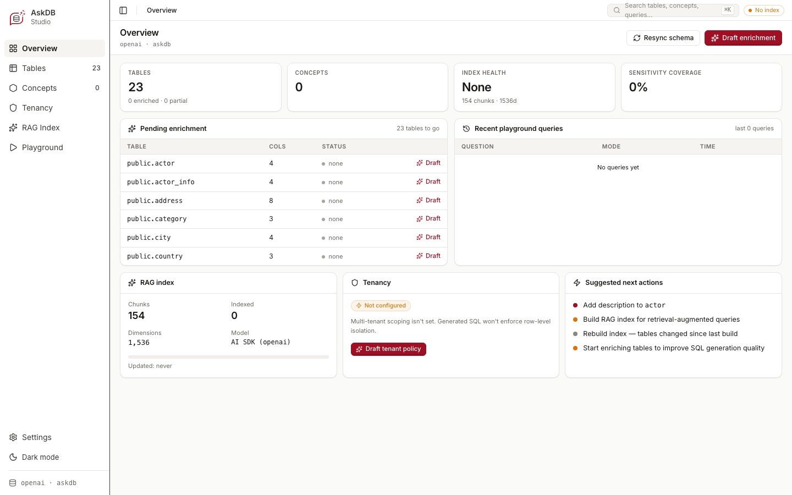
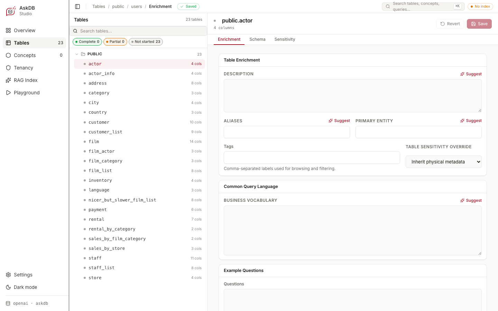
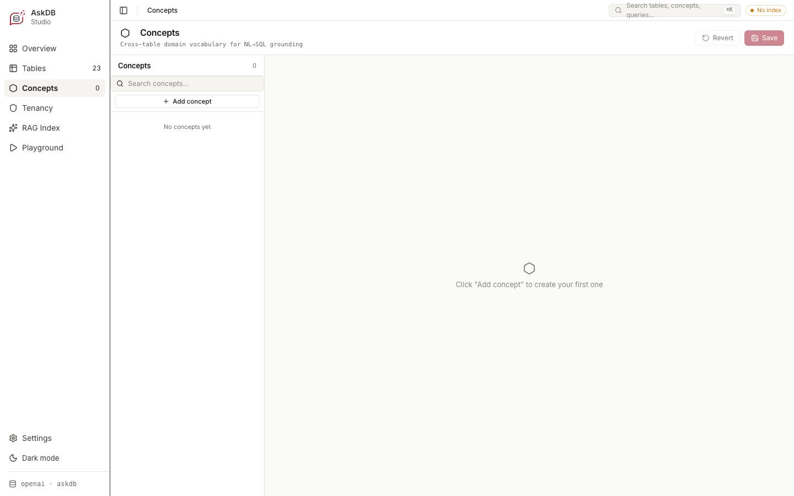
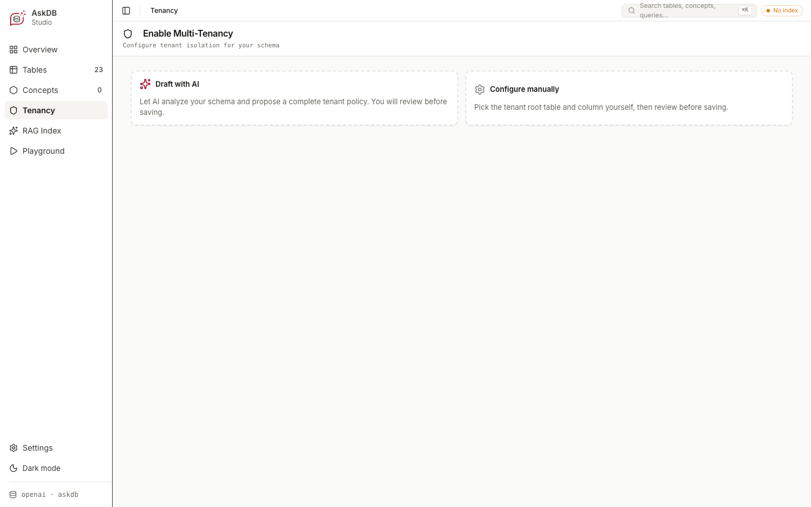
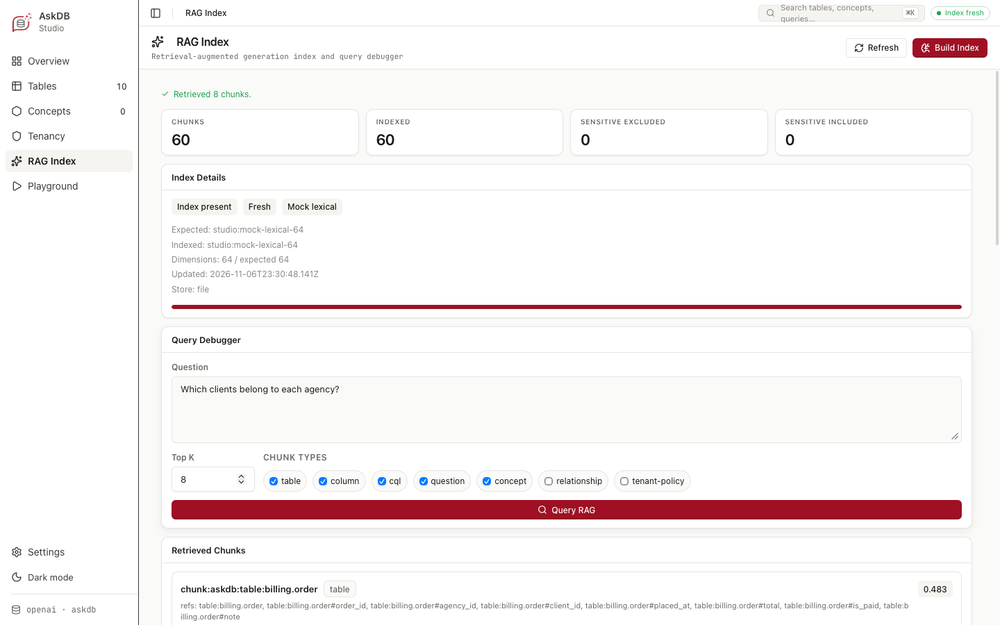
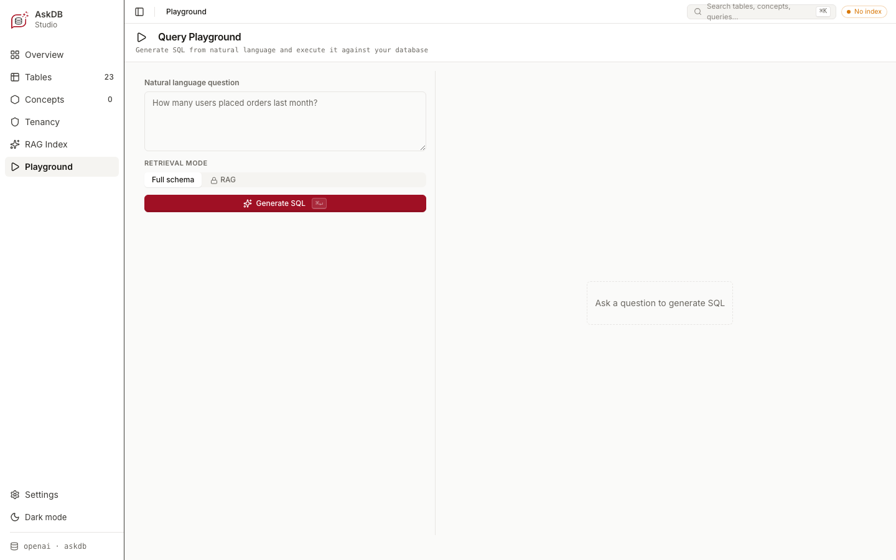
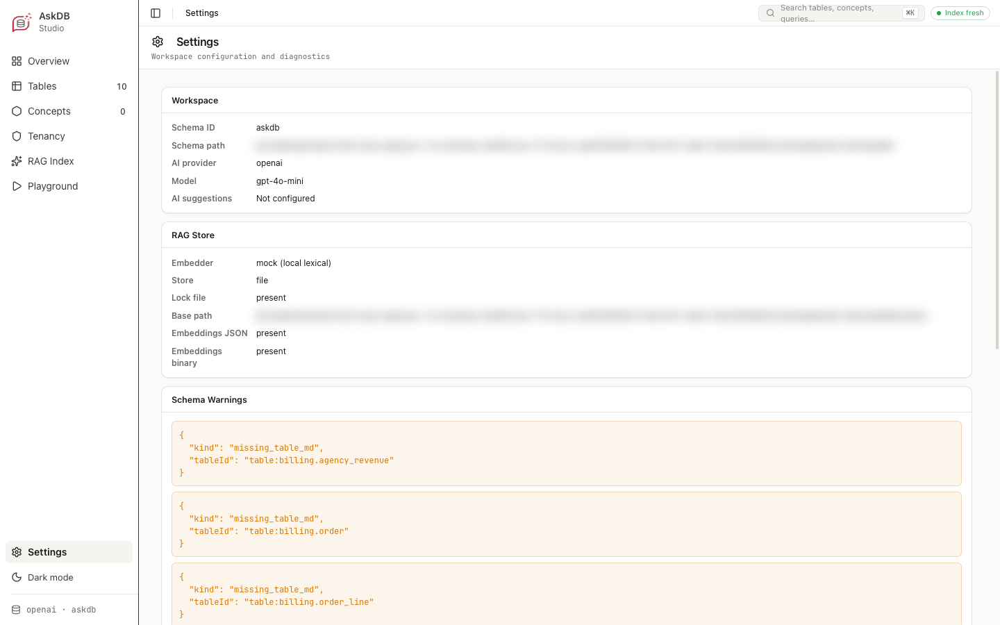

<p class="doc-eyebrow">Visual tour</p>

<p class="doc-lede">Studio is a local web app for enriching your schema artifact and testing questions against the SQL they generate. It reads and writes the artifact on your machine, and its AI features send schema text and your questions to the model provider you configure. This tour walks through its seven views.</p>

Launch it from your project root:

```bash
npx askdb studio
```

Studio prints its address, `AskDB Studio is running at http://127.0.0.1:5556`. Open that in your browser. It reads the schema directory in `introspection.outputDir` from `askdb.config.ts`, or `./askdb/` when that isn't set. The [Studio reference](/reference/studio/#launch) lists the flags, such as `--schema` and `--port`.

## Guided setup

Studio also works as the *first* command in a new project. Run `npx askdb studio` in a directory with no `askdb.config.ts`, or with no schema artifact yet, and Studio opens a setup wizard instead:

1. **Pick your database engine and AI provider.** The wizard asks for environment variable *names* only, never secret values. Studio writes `askdb.config.ts` and an `.env.example`, and installs the packages the config needs.
2. **Add your secrets to `.env` yourself.** The wizard shows which variables to fill in. The values stay on your disk.
3. **Run introspection from the browser.** Studio reads your schema's structure (tables and columns, never rows) and opens the Overview.

`npx askdb init` asks the same questions in the terminal and writes the same files. The [Studio reference](/reference/studio/#guided-setup) says what the wizard writes and installs, and how it picks a package manager.

## The loop

The core Studio workflow is **enrich → ask → re-enrich**. Add descriptions, aliases and example questions to a table, then ask a question in the Playground and read the SQL. If it isn't what you expected, tighten the enrichment and ask again, without leaving the browser tab. Repeating this loop is what makes generation reliable for the words your team uses.

## Overview



The Overview shows the state of your schema artifact:

- **Stat cards:** tables (with how many are enriched and partly enriched), concepts, the RAG index's health, and sensitivity coverage.
- **Pending enrichment:** tables that still need descriptions. Click one to open it in Tables.
- **Recent playground queries,** and cards for the **RAG index** and **Tenancy**.
- **Suggested next actions,** such as describing a table or building the index.

**Resync schema** runs introspection again with the connection in `askdb.config.ts`, as a flag-free `askdb introspect` does. It rebuilds `schema.json` and keeps your enrichment markdown.

## Tables and enrichment



The Tables view lists every table in your schema, grouped by schema, with a search box and filters for **Complete**, **Partial** and **Not started** tables. Select a table to open it in three tabs:

- **Enrichment.** For the table: a description, aliases (the names people use when they ask), a primary entity, tags, common query language and example questions. For each column: a description, aliases and enum notes.
- **Schema.** The columns with their types, nullability, primary key and sensitivity, and the table's relationships.
- **Sensitivity.** Whether the table is **Tracked**: an untracked table stays in the artifact but out of prompts and the RAG index. Then the table's and columns' sensitivity. A mark can only make something sensitive: "Not sensitive" is disabled wherever it couldn't take effect, and the **Effective** column shows what AskDB uses.

**Save** writes the table's markdown file, and **Revert** drops your unsaved edits.

**Suggest** drafts a value with your model, for a table's description, aliases, primary entity and common query language, and for a column's description and aliases. It needs a configured model, and you confirm every draft before it lands. The [Studio reference](/reference/studio/#ai-features) says what each suggestion sends to the model.

## Concepts



Concepts capture business vocabulary that spans tables, such as "active subscription" or "customer" in a schema where that meaning joins several tables. **Add concept** asks for an ID (Studio adds the `concept:` prefix), a label, synonyms, links to the tables and columns it covers, and a description. **Save** writes `concepts.md`.

Concepts reach the model through RAG retrieval: build the index (see [RAG Index](#rag-index)) and ask in RAG mode. Start with the terms your team reaches for most.

## Tenancy



The Tenancy view declares tenant isolation for a multi-tenant schema. Choose **Draft with AI** to have your model propose a tenant policy, or **Configure manually** to pick the tenant root table, its tenant ID column and an enforcement mode (**Strict** or **Warn**) yourself. Either way, you review the policy before **Save** writes `tenant-policy.md`. A saved policy shows its table coverage and an **Edit** button.

[Scope queries to a tenant](/guides/multi-tenancy/) walks through using it, and [Tenant policy format](/reference/tenant-policy/) lists the policy's fields and what the tenant check requires.

## RAG Index



The RAG Index view builds the retrieval index and shows what retrieval returns for a question:

- **Build Index** chunks the artifact and embeds the chunks the store doesn't already hold, so a rebuild after a small change is quick. The cards count the chunks, how many are indexed, and the sensitive chunks left out or kept.
- **Index Details** shows the embedder the index was built with against the one your config names, the vector width, when it was built, and the store. **Stale** means the index no longer matches: the artifact's text changed since the last build, the embedder differs, or a build didn't finish. Build again.
- **Query Debugger** retrieves for a question, with a **Top K** (8 by default) and the chunk types to search. It lists each retrieved chunk with its score and text.

With `rag.embedder: "mock"`, which `askdb init` writes, Studio embeds with a local lexical embedder that needs no key. To embed with a model, see [RAG for large schemas](/guides/rag-for-large-schemas/).

## Playground



The Playground is where you test whether your enrichment works:

1. Type a question in plain language.
2. Choose **Full schema**, which sends the whole enriched artifact, or **RAG**, which retrieves only the relevant chunks. RAG is available once the index exists.
3. With a tenant policy, the **Tenant scope** box is ticked: set the access kind, the tenant root and IDs, and the SQL output, **$N parameters** or **Inline literals**. See [Scope queries to a tenant](/guides/multi-tenancy/#4-try-it-in-studios-playground).
4. Click **Generate SQL**, or press ⌘↵ (Ctrl+Enter).

The SQL appears with an **Explain** panel that shows the result of AskDB's SQL checks. The Playground doesn't show which chunks retrieval picked: run the same question in the [RAG Index](#rag-index) Query Debugger for that. Like the CLI, the Playground follows `modes.omitSensitiveFromPrompt`.

For a schema whose engine AskDB ships no dialect for, the Playground generates nothing and says so, as the CLI and the HTTP API refuse it: set [`dialect`](/reference/config/#dialect) in `askdb.config.ts` to the built-in dialect your engine speaks.

Running the generated SQL against your database is off by default. [Enable Studio execute](/guides/enable-studio-execute/) turns it on.

### Get the code

Once the SQL looks right, the **Get the code** panel turns the session into TypeScript you can paste: your question, the schema path, the dialect, your AI provider and, when it's on, the tenant scope. For a schema whose engine AskDB ships no dialect for, it shows why instead of code. Choose the config-driven style (`createAskDb()` from `@askdb/client`, which reads the same `askdb.config.ts`) or the direct style (`ask()` from `@askdb/core` with a model you pass). Then continue with [Embed in a Node app](/guides/embed-in-node/).

## Settings



Settings, at the bottom of the side rail, shows how Studio is set up. It changes nothing:

- **Workspace:** the schema ID and path, the AI provider (`ai.provider`) and model (`ai.language.model`, or the provider's default), and whether AI suggestions are configured.
- **RAG Store:** the embedder (`rag.embedder`, with `ai.embedding` for `"ai"`), the store (`rag.store` and `rag.storeConfig`), and whether the lock file and the store's files exist.
- **Schema Warnings:** the warnings from loading your schema artifact, such as a table with no markdown file. [Loader warnings](/reference/schema-artifact-format/#loader-warnings) explains each kind.

The rail's **Dark mode** button switches Studio's theme.

## Read next

<div class="home-path-grid">
  <a href="/guides/enable-studio-execute/"><strong>Enable Studio execute</strong><span>Run the Playground's SQL against your database under a read-only role.</span></a>
  <a href="/reference/studio/"><strong>Studio reference</strong><span>Flags, files, what each AI feature sends, and the security model.</span></a>
  <a href="/guides/author-your-schema/"><strong>Enrich your schema</strong><span>The enrichment workflow, and keeping the artifact current.</span></a>
  <a href="/quickstart/"><strong>Quickstart</strong><span>Create a sample database, ask a question from the CLI, and run the SQL.</span></a>
</div>
