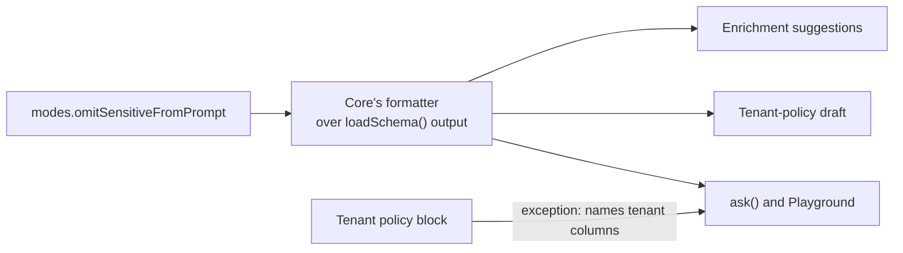

# ADR 0026: Every prompt follows omission

**Status:** accepted · 2026-11-05

## Decision

`modes.omitSensitiveFromPrompt` is a floor for every prompt that puts schema names in front of a language model. That covers `ask()`, Studio's Playground, Studio's tenant-policy draft (ADR 0021) and enrichment suggestions.

Every such prompt lists schema through core's formatter, from the schema that `loadSchema()` returns. So front-matter escalation and table-wide inheritance reach each prompt. Core's enrichment types take a normalized table, not a raw `schema.json` table.

Under omission, a sensitive column cannot be the target of an enrichment suggestion. The prompt would have to name it, so core throws before any model call.

The tenant policy block is the one exception. Under omission it still names the tenant columns of the tables it shows, sensitive ones included.

## Why

- The setting is a floor for prompts, and a second rule for one prompt drifts. Three paths skipped the setting or the front-matter flags.
- The tenant check requires a predicate on the tenant columns. Without their names, the model cannot write it, and the check rejects the SQL for every sensitive scoped table.
- The tenant block names identifiers that the check requires, never values. The database role stays the boundary (ADR 0012).

## Options

| | Option | Why it lost |
|---|---|---|
| A | Every prompt follows the setting through core's formatter, and the tenant block is the exception | **Chosen.** |
| B | Leave enrichment unchanged, because it is authoring on the operator's own schema | The setting is a floor for every prompt sent to a model, and a second rule drifts. |
| C | Merge the front-matter flags in `@askdb/enrich` | It makes a third copy of the loader's escalation rule. |
| D | Keep enrichment's own column lines and copy the omission rule into them | The tag, the placeholder line and the omission rule would have two homes. |
| E | Send a sensitive column's suggestion prompt without its name | The model would suggest blind. |
| F | A branded table type that only `loadSchema()` can create | `ask()` does not prove where its schema's flags came from either, and every table built by hand would need a cast. |
| G | A runtime check in core that every `sensitive` flag is a boolean | A raw table has boolean flags too, so the check cannot tell a raw table from a loaded one. |
| H | Withhold sensitive columns from the tenant policy block too | Omission then fails every query on a sensitive tenant-scoped table. |

## Keep

| Rule | Checked by |
|---|---|
| No prompt skips the setting. With omission on, the Playground, the tenant-policy draft and enrichment suggestions name no sensitive column. | `apps/studio/src/server.test.ts` |
| No prompt renders schema outside core's formatter. | review |
| Enrichment reads the sensitivity that `loadSchema()` computes, so a column made sensitive in front-matter is tagged or withheld. | `apps/studio/src/server.test.ts` |
| Under omission, a sensitive column as the target throws before any model call. The message does not name the column. | `packages/core/src/enrichment/suggest.test.ts`, `apps/studio/src/server.test.ts` |
| Core's enrichment types require a normalized table. The type is the only check, and core adds none at runtime. | review |
| The tenant policy block is the one exception: under omission it still names sensitive tenant columns. The contracts, the docs-site privacy page and the review profile say so. | `packages/core/src/sql/tenant-prompt.test.ts` |
| The tenant policy block names only the tables the prompt shows (ADR 0038). | `packages/core/src/ask.test.ts`, `packages/core/src/sql/tenant-prompt.test.ts` |

Embedding calls are outside this decision. They do not read the setting, and the RAG chunker leaves sensitive content out of the index by default.
