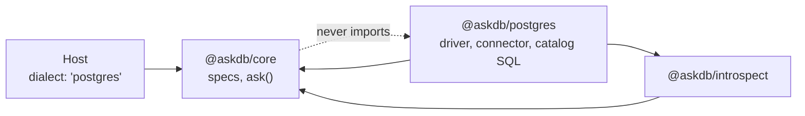

# ADR 0029: Core owns the built-in dialect specs

**Status:** accepted · 2026-11-05

## Decision

`@askdb/core` owns the SQL rules of the six built-in dialects: `postgres`, `cockroachdb`, `mysql`, `mariadb`, `sqlite` and `sqlserver`. The rules are the prompt brief, the forbidden keywords and functions, list binding, escaping and quoting, the namespace rules and the reserved words. Core resolves a dialect id itself, so `ask({ dialect: "postgres" })` works with only `@askdb/core` installed.

The engine packages own everything that talks to a database: the driver, the introspection connector, the catalog SQL and connection resolution. Each engine package re-exports its spec from core.

`DialectId` is a closed union. A host that adjusts a built-in engine spreads its spec and keeps the `id`. Any other engine implements `AskDialect`.

## Why

- Every engine package depends on core. A spec that lives in an engine package forces core to import that package, and that import is a cycle.
- The other way to break the cycle is a registry that the host fills. It breaks every caller that passes a dialect id.
- 1.0 freezes the import path of each spec. A move after 1.0 needs a major release.

## Options

| | Option | Why it lost |
|---|---|---|
| A | Core owns the built-in specs | **Chosen.** |
| B | The engine packages own the specs, and core keeps only the `DialectSpec` type | A dialect id then needs core to import the engine packages (a cycle) or a registry the host fills (a break for every id caller). |
| C | A new `@askdb/dialects` package that core and the engine packages depend on | It adds a published package to version and install, and hosts gain nothing from it. |
| D | Introspection records the server's reserved words in the schema artifact | It changes the Schema v2 format, the artifact goes stale when the server is upgraded, and `from-export` and Prisma have no live server. |

## Keep

| Rule | Checked by |
|---|---|
| Core imports no engine package and no driver. It opens no connection and executes no SQL. | review |
| Core resolves each built-in dialect id to its own spec. | `packages/core/src/sql/dialect-spec.test.ts` |
| The built-in ids are exactly the six. A new id, or a move of the specs out of core, needs a new ADR. | `packages/core/src/sql/dialect-spec.test.ts` |
| `ask()` refuses a `DialectSpec` whose `id` is not built in, before any model call. | `packages/core/src/ask.test.ts` |
| Behaviour that core selects by `id` stays in core. It does not become data on `DialectSpec` before 1.0. | review |
| Each engine package keeps the re-export of its spec. A removal is a breaking change to that package. | review |
| `ASKDB_DIALECTS` in `@askdb/config` lists the same ids as core. | review |
| Each reserved-word list names its source and the server versions it was checked against. | review |
| `cockroachdb` is a built-in id outside the 1.0 support claim, which covers five engine families. | review |

A new built-in dialect is a change to core. ADR 0007's rule that a new engine needs no change to core holds for introspection only. ADR 0032 decides how a rebind treats a spread spec.

## Related

How-to: [Adding a new engine's dialect rules](../integration/dialects.md).
