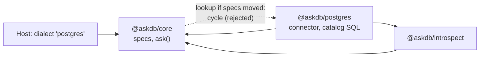

# ADR 0029 — `@askdb/core` owns the built-in dialect specs

## Status

Accepted (2026-11-05, maintainer decision on #464: option A, no code moves before 1.0). The code already has this layering; this ADR records it as intended.

Supersedes in part [ADR 0002](0002-integration-package-layout.md): its first Decision bullet's "does not know what SQL dialect is being generated", the "own their dialect" in its integration-package bullet, and its rationale "Dialect is integration-package knowledge". ADR 0002's 2026-10 amendment described the gap between that text and the code; this ADR settles it. It also settles the dialect lines in the out-of-scope lists of [ADR 0007](0007-connector-registry.md) and [ADR 0008](0008-engine-packages-and-connector-registry.md).

## Context

ADR 0002 (2026-05) made `@askdb/core` dialect-agnostic and gave each integration package its own dialect. The code went the other way. The six built-in `DialectSpec`s (`postgres`, `cockroachdb`, `mysql`, `mariadb`, `sqlite`, `sqlserver`) live in `packages/core/src/sql/dialect-spec.ts`, and each new per-engine fact landed beside them. The most recent is the reserved words the prompt quotes (#451, #460), in `packages/core/src/sql/reserved-words.ts`. Core also switches on `DialectSpec.id` to lex SQL, quote identifiers in the prompt, pick parameter markers and read SELECT modifiers. The engine packages re-export the specs: `postgresDialect` from `@askdb/postgres`, `MYSQL_DIALECT` from `@askdb/mysql`, and so on.

Three facts constrain where the specs can live:

- **String ids work with core alone.** `ask({ dialect: "postgres" })` works with only `@askdb/core` installed. The core API reference promises it, and `@askdb/client`, the CLI, Studio and `askdb.config`'s `dialect` field resolve ids through core's `getDialectSpec` and `isBuiltInDialectId`.
- **Every engine package depends on core.** Each imports `@askdb/core` directly (`AskDbError`, `SINGLE_NAMESPACE_LABEL`, the schema types) and through `@askdb/introspect`.
- **1.0 freezes the public API.** That includes where `POSTGRES_DIALECT` and the other specs are imported from, so a move after 1.0 breaks imports.

#460's review added evidence about the reserved words. The MySQL/MariaDB list was built from both engines' docs. Yet MariaDB 11.4 rejects `portion` as a bare column, and MySQL 8.4 and MariaDB 11.4 both reject SELECT modifiers such as `sql_no_cache`. None of these words were on the list until each word in the servers' `information_schema.KEYWORDS` was tried as a bare column on the multi-engine fixture. The same check on PostgreSQL 17 (`pg_get_keywords()`) matched the Postgres list exactly. Reserved words are per engine and per server version, and only the engine packages talk to a server.

## Decision

`@askdb/core` owns the SQL rules of the built-in engine families. The engine packages own everything that talks to a database. Core still imports no driver, opens no connection and executes no SQL.

**`@askdb/core` owns:**

- **The prompt brief:** `promptBrief`, one paragraph per engine in the NL→SQL prompt.
- **The forbidden keywords and functions:** the base read-only denylist (`BASE_FORBIDDEN` in `validate.ts`), each spec's `extraForbiddenKeywords`, and its `blockedFunctions`.
- **List binding:** `listBinding`, and the parameter markers each engine family uses (`markerStyleForDialect` in `bind.ts`).
- **The escaping and quoting rules:** `backslashEscapes` and `identifierQuote`, plus the lexer profile (`lexerProfileFor`) and the prompt's identifier quoting (`promptIdentifierQuoter`), both chosen by `id`.
- **The namespace rules:** `unqualifiedNamespace`, and `SINGLE_NAMESPACE_LABEL`, the namespace connectors give an engine without schemas.
- **The reserved-word lists:** `reserved-words.ts`, set on each built-in spec as `reservedWords`.
- **The built-in set:** `DialectId`, `BUILT_IN_DIALECTS`, and the string-id lookup (`getDialectSpec`, `isBuiltInDialectId`).

**The engine packages own:**

- **The driver**, an optional peer: `pg`, `mysql2`, `better-sqlite3`, `mssql`.
- **The introspection connector** and its input shape (`create<Engine>Connector`).
- **The catalog SQL:** the catalog queries, the templates (`POSTGRES_TEMPLATE_BUNDLE`) and the catalog query runner (`create<Engine>CatalogQueryRunner`).
- **Connection resolution** and the parts of the connection label, through their `ConnectorProviderAdapter` ([ADR 0008](0008-engine-packages-and-connector-registry.md), [ADR 0011](0011-connection-labels-from-parsed-parts.md)).
- **The re-exports of the specs:** `@askdb/postgres` exports `POSTGRES_DIALECT` (also as `postgresDialect`), `@askdb/mysql` exports `MYSQL_DIALECT` and `MARIADB_DIALECT`, `@askdb/sqlite` exports `SQLITE_DIALECT`, and `@askdb/sqlserver` exports `SQLSERVER_DIALECT`. The objects are core's; the re-export saves the host an import.
- **The check of their spec's reserved words against their server** (see [Keeping the rules honest](#keeping-the-rules-honest)).

For 1.0:

- `ask({ dialect: "<id>" })` keeps working with only `@askdb/core` installed.
- `DialectId` stays a closed union of the six built-in ids.
- The behaviour core selects by `id` (lexing, prompt quoting, parameter markers, SELECT modifiers) stays in core's switches. It does not become data on `DialectSpec` before 1.0.

## Why moving the specs would risk a cycle

- **A string id would need core to import the engine package.** If the Postgres spec lived in `@askdb/postgres`, `ask({ dialect: "postgres" })` could find it only by importing `@askdb/postgres`. That package already imports core, directly and through `@askdb/introspect`, so the import would close a cycle.
- **Breaking the cycle breaks string ids.** The host would register each spec (`registerDialect(POSTGRES_DIALECT)`), or `ask()` would take spec objects only. Every `dialect: "<id>"` caller would break: hosts, `@askdb/client`, the CLI, Studio and `askdb.config`'s `dialect` field.
- **SQL generation would need an introspection package.** A host that only generates SQL would install a package built to read catalogs, with a driver as its optional peer.
- **Data passed in makes no cycle.** An engine package may build a `DialectSpec` and hand it to `ask()`, because it depends on core for the type. Only core resolving an id through an engine package makes a cycle.

## How a new engine adds its rules

**A first-party engine** is a change to core plus a new engine package.

- **In core:**
  - Add its id to `DialectId`, and its spec to `dialect-spec.ts` and `BUILT_IN_DIALECTS`.
  - Add its reserved words to `reserved-words.ts`. Write a source comment (the document and the date fetched) and a `Checked` comment (the server versions it was checked against) above the list.
  - Add its cases to the switches on `id`: the lexer profile, the prompt quoting, the parameter markers in `bind.ts` and the SELECT modifiers in `sensitive-guardrail.ts`.
- **In its engine package:**
  - Build the connector, catalog SQL and driver loading on the engine kit (ADR 0008).
  - Re-export its spec.
  - When the engine joins the multi-engine fixture, check its reserved words against the server.

**A third-party engine** needs no AskDB change, but it gets no string id.

- An engine that speaks a built-in family's SQL can spread that spec and pass the object to `ask()`: `{ ...POSTGRES_DIALECT, displayName: "…", promptBrief: "…" }`. It keeps the family's `id`, so it keeps that family's lexing, quoting and markers. Any list it sets replaces the family's list.
- Any other engine implements `AskDialect`, the escape hatch. `ask()` doesn't run the read-only validator on an `AskDialect`'s SQL, so the engine calls `validateSelectSql` itself.
- A `DialectSpec` with a new `id` needs a change to core, because `DialectId` is closed.
- It introspects through its own `ConnectorProviderAdapter`, registered in a host's connector registry (ADR 0008).

## Keeping the rules honest

The rules are of two kinds, and each kind is checked against its own source of truth.

- **What the engine reserves** is a fact about the server, and it changes with the server version. Core holds these lists because the prompt needs them with only core installed. Each list names its source and the server versions it was checked against. A list may hold words the server doesn't reserve, because quoting a name that isn't reserved changes nothing. A word missing from a list reaches the model unquoted, and the model can copy it bare into SQL the server rejects.
- **What AskDB rejects** is core's own rule: the read-only denylist, and each spec's forbidden keywords and blocked functions. The prompt quotes these words too. For example, no engine reserves `copy`, but `validateSelectSql` rejects it unquoted. Core's own tests cover these rules.

Each engine package checks the reserved words of the spec it re-exports against its own server, in its multi-engine fixture suite. Those suites run in CI's integration job with `ASKDB_FIXTURE_HOST` set. The engine package already has the driver, so core gets no driver, not even as a dev dependency.

- **PostgreSQL:** each word from `pg_get_keywords()`, tried as a bare column name.
- **MySQL and MariaDB:** each word from `information_schema.KEYWORDS`, tried as a bare column name. MariaDB's table has no reserved flag, so trying each word is the only test.
- **The test fails** when the server rejects a word the list doesn't hold. A listed word the server accepts is not a failure.
- **SQL Server and SQLite** publish no keyword catalog in SQL, so their lists come from the vendor docs alone. CockroachDB isn't in the fixture; its extra words come from its parser source.

#632 builds this check. Until it lands, the lists carry the manual check of 2026-10-05. When the fixture moves to a new server version, the check shows the words that version added, and a core release adds them.

## Options considered

- **A. Core owns the built-in specs (chosen).** It matches the code and keeps string ids working with only core installed. It needs no work before 1.0.
- **B. Move the specs into the engine packages; core keeps only the `DialectSpec` type (rejected).** String ids would then need core to import the engine packages (a cycle) or a registry the host fills (a break for every `dialect: "<id>"` caller). Everything core reads from `id` would also have to move onto the spec first. That is a large refactor just before the RC.
- **C. A new `@askdb/dialects` package that core and the engine packages both depend on (not now).** It avoids the cycle and keeps string ids. But it adds a published package to version and install before 1.0, and users gain nothing from it. It stays possible after 1.0 without a break, as long as core keeps re-exporting the specs.
- **D. Introspection records the server's reserved words in the schema artifact (deferred, #633).** The prompt would then quote exactly the target server's words, and a new server version would need a re-introspection, not an AskDB release. But it changes the Schema v2 format, and an artifact goes stale when its server is upgraded. `from-export` and Prisma introspection have no live server. It can come after 1.0 as an optional field, with core's lists as the fallback.

## Consequences

- **ADR 0007's "no changes to `@askdb/core`"** holds for introspection only. A new built-in dialect is a change to core.
- **The docs describe core as owning the built-in dialect rules**, not as dialect-agnostic: `docs/architecture.md`, the package READMEs and the docs site.
- **A reserved word a new server version adds** is fixed by a core release, not an engine-package release.
- **Moving the specs out of core after 1.0** needs a major release, unless core keeps re-exporting them (option C).
- **The engine packages keep their re-exports through 1.0.** Removing one is a breaking change to that package.

## Related

- [ADR 0002 — Integration-package layout](0002-integration-package-layout.md) (superseded in part)
- [ADR 0007 — Connector provider registry](0007-connector-registry.md)
- [ADR 0008 — Engine packages, the engine kit and the connector registry](0008-engine-packages-and-connector-registry.md)
- `packages/core/src/sql/dialect-spec.ts`, `packages/core/src/sql/reserved-words.ts`
- [Multi-engine fixture](../../fixtures/multi-engine/README.md)
- #464 (this decision), #451 and #460 (the reserved words), #632 (the fixture check), #633 (option D)
