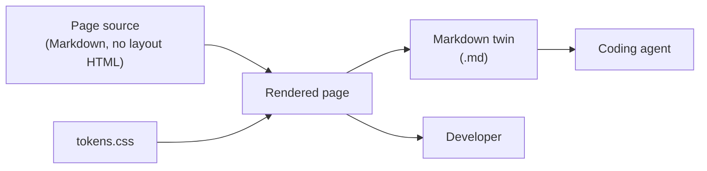

# ADR 0050: Docs pages are Markdown first, and each has a Markdown twin

**Status:** accepted · 2026-11-14

## Decision

A docs page's furniture is Markdown. The first paragraph is the lede. A list in which every item is `[Title](/path/): description` renders as link cards. The breadcrumb comes from the sidebar groups. Raw HTML in a page is limited to `<figure>`, `<figcaption>` and `
`.

Every page has a Markdown twin, at its URL with the trailing slash replaced by `.md`. The twin is built from the rendered page, so it shows what the page shows. Each page links its twin, and `/llms.txt` lists the common tasks by their twins.

The look comes from design tokens. `apps/docs-site/src/styles/tokens.css` holds every color, font, radius and shadow for both themes, and the other stylesheets read them. The fonts are self-hosted.

## Why

- The site has two readers: a developer who looks at a page, and a coding agent that reads it as text.
- An agent's one text view was the whole site in one file. Layout HTML in a page's source ran a card's title into its description.
- A twin made from the MDX source loses the meaning that components carry: tabs, file trees and asides render nothing useful as raw MDX.

## Options

| | Option | Why it lost |
|---|---|---|
| A | Markdown furniture, and a twin made from the rendered page | **Chosen.** |
| B | Keep HTML furniture, and serve only the site-wide `llms*.txt` files | Every page keeps layout markup in its source. An agent that wants one page fetches all of them or parses HTML. |
| C | A twin made from each page's MDX source | Components render nothing useful as raw MDX, and imports and JSX reach the reader. |

## Keep

| Rule | Checked by |
|---|---|
| Every built page has a clean twin and a `text/markdown` alternate link to it, or the build fails. | `apps/docs-site/scripts/check-markdown-twins.test.mjs` |
| A page's twin is its path with the trailing slash replaced by `.md`. The home page's twin is `/index.md`. | `apps/docs-site/src/utils/markdown-twin.test.mjs` |
| The twin shows what the page shows: each tab with its label, each code block with its language and title, and each diagram as text. | `apps/docs-site/src/utils/html-to-markdown.test.mjs` |
| A list of `[link]: description` items renders as link cards, and reads as the same list in the twin. | `apps/docs-site/plugins/remark-link-cards.test.mjs`, `apps/docs-site/src/utils/html-to-markdown.test.mjs` |
| A page asked for as `text/markdown` gets its twin with `Vary: Accept`, and a missing path gets a 404 with a Markdown body that links `/llms.txt` (or a JSON error, asked for as `application/json`). GitHub Pages can't negotiate, so the edge worker in `apps/docs-site/edge/` does. | `apps/docs-site/edge/worker.test.mjs` |
| Every common task in `/llms.txt` links to the twin of a page that exists. | `apps/docs-site/src/utils/llms-txt.test.mjs` |
| Every page is in a documentation set, so a new top-level docs folder needs one. | `apps/docs-site/src/utils/llms-txt.test.mjs` |
| A page holds no layout HTML: raw HTML is `<figure>`, `<figcaption>` and `
` only. | review |
| No color or font is set outside `tokens.css`. A page never sets its own. | review |
| Pages request no font from another host. | review |
| A fact that only layout shows is a defect: the page says it in words. | review |

A `mermaid` diagram's twin text is its source (ADR 0041). A `diagram` fence's twin text is its text alternative (ADR 0051). `apps/docs-site/STYLE.md` holds the rules for authors.
