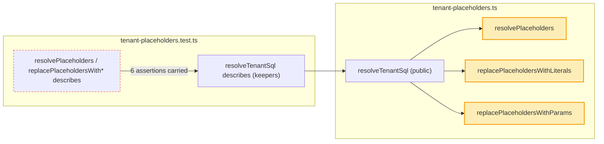

# Spec: apply the core-guardrails test campaign plan (#508)

## For the owner

This spec applies the campaign's plan to the tenant guardrail tests in `@askdb/core`: it repairs 3 tests that cannot fail, deletes 18 duplicates and 2 self-comparing tests after moving 6 assertions into the tests that keep them, and makes three helpers that only tests use module-internal. Package behaviour does not change.

| Decision | Answer | Settled by | Undo |
| --- | --- | --- | --- |
| D1. One PR or two | One ticket, one PR; no split into two quick tickets | default D1 (triage) | Two-way: revert the PR |
| D2. Changeset | One `patch` changeset for `@askdb/core`: "test-only helpers made module-internal; no public API change" | default D2 (triage) | Two-way |
| D3. Backslash tenant ID with a custom `AskDialect` | Out of scope; the tests pin today's behaviour, and it goes to its own issue if it reproduces | default D3 (triage) | Two-way |

The three helpers lose `export` (amber). The tests that called them directly are deleted (dashed) or rewritten to go through `resolveTenantSql`.

**Risks:** every changed file is under `packages/core/src/sql/**`, a sensitive path. A deleted test could take with it the only proof of a branch; each deletion keeps a named keeper, and the three repairs are checked by mutation.

**Done when:** each F row fails under its named mutation; each C and D row is gone and its keeper (with its carry) passes; the three helpers are not exported and nothing imports them; `pnpm test` and `pnpm lint` pass; the patch changeset is present.

**Needs you:** nothing.

Reply `/approve`, `/changes <what to change>`, or `veto D<n>` to reopen a default.

## Problem Statement

The weekly test campaign audited the `core-guardrails` subsystem of `@askdb/core` (tenant scoping and sensitive-field guardrails, 177 test declarations in seven files under `packages/core/src/sql`). Most tests are sound, but 23 are not:

- Three tests pass for a reason other than the contract their name gives. Two tenant prompt tests look for strings that also appear in the scope's `columns:` line and the static Enforcement rules, so they pass with the section they name removed. The tenant guardrail test "rejects polymorphic table missing type discriminator" passes because its SQL has no tenant placeholder at all, so `MISSING_TENANT_PREDICATE` throws before the discriminator check runs. The discriminator branch has no other test that fails if it is removed.
- Eighteen tests duplicate a stronger test elsewhere in the lane or in `ask.test.ts`.
- Two tests cannot fail: one compares two calls on identical input, the other asserts output of a helper on a path production never reaches.
- Three helpers in the tenant placeholder module (`resolvePlaceholders`, `replacePlaceholdersWithLiterals`, `replacePlaceholdersWithParams`) are exported only so tests can call them. They are not in the package's `index.ts` (the package's only export entry), and no other code in the repo imports them.

A maintainer or agent reading the suite cannot trust that a green run proves the guardrail contracts, and the extra tests make a real change to the binder fail in many places at once.

## Solution

The suite keeps one test for each contract, at the public seam where one exists, and each kept test can fail for the regression it names. The issue's ledger is the row list: build works through every F, C and D row in it, and the issue's layer plan names each row's keeper and the assertions to carry. The repairs make the three weak tests assert the exact lines and rule they claim to prove. The three helpers become module-internal, so `resolveTenantSql` is the only way into tenant substitution, for tests as for hosts. Hosts see no change: no public export, signature or output moves.

## User Stories

1. As a maintainer, I want the tenant prompt test for scoped tables to fail when the "Tenant-scoped tables" section is removed, so that a green run proves the model is told which tables need a tenant predicate.
2. As a maintainer, I want the tenant prompt test for polymorphic tables to fail when the polymorphic section is removed, so that a green run proves the model is told each type column, id column and type mapping.
3. As a maintainer, I want the guardrail test for a polymorphic table without a type discriminator to fail when the discriminator check is removed, so that the `MISSING_TYPE_DISCRIMINATOR` rule has a test that proves it.
4. As a maintainer, I want that repaired test to assert the `MISSING_TYPE_DISCRIMINATOR` rule, not just any `TenantGuardrailError`, so that a different rule firing does not make it pass.
5. As a maintainer, I want each duplicate test deleted only after its distinct assertions move into its keeper, so that no assertion is lost in the consolidation.
6. As a maintainer, I want each keeper named in the ledger to exist and pass after the change, so that every deleted test has a proof that remains.
7. As a maintainer, I want the self-comparing "is deterministic" prompt test removed, so that the suite holds no test that cannot fail.
8. As a maintainer, I want the test of `resolvePlaceholders`' global-scope output removed, so that the suite does not pin a path that `resolveTenantSql` never reaches.
9. As a maintainer, I want the keeper for the sql-only `resolveTenantSql` case to assert the whole binding (placeholder, root label, root id, ids), so that the binding shape is pinned at the public seam instead of the internal helper.
10. As a maintainer, I want the global-scope keeper to assert empty `bindings` in both modes and empty `params` with `mode: "sql-params"`, so that the global contract keeps the checks the deleted global tests made.
11. As a maintainer, I want the deprecated `placeholderForRoot` keeper to keep the `Agency` and `My Cool Root` cases, so that the label-only derivation stays pinned after the duplicate test goes.
12. As a maintainer, I want the no-dialect backslash case (quote-doubling only) pinned through `resolveTenantSql` in the backslash describe, so that today's behaviour for custom `AskDialect`s stays pinned while its own issue is decided.
13. As a maintainer, I want the two `?` marker ordering tests to call `resolveTenantSql` with a `multi_root` scope, so that they keep their exact SQL and params while the helper they called becomes internal.
14. As a maintainer, I want `resolvePlaceholders`, `replacePlaceholdersWithLiterals` and `replacePlaceholdersWithParams` not exported, so that tests reach tenant substitution only through the public `resolveTenantSql`.
15. As a host app developer, I want the public exports of `@askdb/core` unchanged, so that my imports and outputs stay the same after this release.
16. As a release reader, I want a patch changeset that says no public API changed, so that the `@askdb/core` changelog entry is not mistaken for a behaviour change.
17. As a later agent, I want the deleted tests' rows checked off in the issue's ledger in the PR, so that I can see which keeper took each one without re-running the campaign.
18. As the core-schema campaign's owner, I want `tenant-scope-validate.test.ts` left untouched, so that its tenant-policy deletions still rely on that file's scope-validation tests.

## Implementation Decisions

- **One PR (D1).** All F, C and D rows and the `export` drops land in one PR on this branch. The two halves the campaign suggested share keeper tests, so splitting them would edit the same describes twice.
- **The ledger is the work list.** Build follows the issue's "Ledger rows (F, C, D)" and "Layer plan" sections row by row. Line numbers there are as of `2ff9332c`; build finds each test by its describe and title, which are stable.
- **F repairs.**
  - Tenant prompt, "includes scoped table instructions": assert the section header `Tenant-scoped tables (MUST include tenant predicate):` and the orders line, `  - table:public.orders → filter via table:public.orders#agency_id (Agency scope)`, in place of the three loose `toContain` probes.
  - Tenant prompt, "includes polymorphic table instructions": assert the notes line, `  - table:public.notes: type column = table:public.notes#owner_type, id column = table:public.notes#owner_id`, and one mapping line, `    - 'agency' → Agency`.
  - Tenant guardrail, "rejects polymorphic table missing type discriminator": use SQL with the id column bound to the tenant placeholder and no type column (`SELECT * FROM notes WHERE owner_id = :tenant_agency_ids`), and assert that the thrown `TenantGuardrailError` carries one warning, with rule `MISSING_TYPE_DISCRIMINATOR` (the guardrail collects warnings, so the original SQL raised `MISSING_TENANT_PREDICATE` as well). A row in the polymorphic behaviour table is an equal choice if it fits that table's shape.
  - If the builder's exact output differs from the quoted lines, build asserts the lines the builder emits for that section today; the test must still fail with the section removed.
- **C rows: carries into keepers (the layer plan's carries 1 to 5).**
  1. Deprecated `placeholderForRoot` keeper (`keeps the deprecated label-only placeholderForRoot output unchanged`) gains `Agency` → `:tenant_agency_ids` and `My Cool Root` → `:tenant_my_cool_root_ids`.
  2. `resolveTenantSql — sql-only mode`, "inlines literal values" asserts `bindings` equal to `[{ placeholder: ":tenant_agency_ids", rootLabel: "Agency", rootId: "table:public.agencies", ids: ["42"] }]`, replacing its `rootLabel`-only check.
  3. The "a crafted tenant ID with a backslash" describe gains a no-dialect row: `resolveTenantSql` in sql-only mode, with no dialect, an `ids` scope on agencies with ID `acme\`, returns `… agency_id = 'acme\'` (quote-doubling only).
  4. "global scope is unaffected" asserts `bindings` is `[]` in both modes, and `params` is `[]` with `mode` `"sql-params"`.
  5. The two tests in `replacePlaceholdersWithParams — ? marker ordering` call `resolveTenantSql` in sql-params mode with a `multi_root` scope (agencies `["a1", "a2"]`, clients `["c1", "c2", "c3"]`) and the MySQL and SQLite dialect specs, with the same expected SQL and params. The describe's title drops the helper name.
  - The C rows with "No carry" in the ledger are deleted as they are.
- **D rows.** Delete the tenant prompt "is deterministic" test and the `resolvePlaceholders` "returns empty for global scope" test. Their proofs remain in the exact-block prompt tests and the global-scope keeper.
- **Test-only seams.** `resolvePlaceholders`, `replacePlaceholdersWithLiterals` and `replacePlaceholdersWithParams` lose `export` and stay as module-internal functions with unchanged bodies and signatures. `resolveTenantSql` keeps calling them. `index.ts` does not change. The test file's import list drops the three names.
- **No production behaviour change.** No function body, signature, error, or exported type changes. Code that becomes unreachable through `resolveTenantSql` after the `export` drop (for example `resolvePlaceholders`' global branch) stays as it is; removing it is not part of this ticket.
- **Changeset (D2).** One `patch` changeset for `@askdb/core`, saying the three test-only tenant placeholder helpers are now module-internal and no public API changes.
- **Files expected to change:** the tenant placeholder, tenant guardrail and tenant prompt test files; the tenant placeholder module (three `export` keywords); one changeset. About 250 changed lines, mostly deletions.

## Testing Decisions

- **What a good test is here:** each kept test asserts the public behaviour its name gives (prompt lines, guardrail rule, substituted SQL and params, bindings) through a public entry (`buildTenantPromptBlock`, `validateTenantGuardrails`, `resolveTenantSql`, `ask()`), and fails for the regression it names. Build gates each new or changed assertion with the `factory-test-audit` skill.
- **Mutation checks for the F repairs.** Build confirms each repair goes red, then restores the code: remove the guardrail's no-discriminator branch (the `!typeMentioned` check in the tenant guardrail) and the repaired discriminator test must fail; remove the scoped-tables section and then the polymorphic section of the tenant prompt builder and the repaired scoped-tables and polymorphic tests must fail. The PR body records each mutation and its result.
- **Keepers.** After the deletions, every keeper the ledger names exists and passes. Build checks the C rows marked "No carry" against their keeper before deleting them; if a keeper does not hold the assertion the ledger says it holds, build carries the assertion instead and says so in the PR.
- **Commands:** `pnpm --filter @askdb/core exec vitest run --config ../../vitest.config.ts src/sql/tenant-placeholders.test.ts src/sql/tenant-guardrail.test.ts src/sql/tenant-prompt.test.ts`, `pnpm --filter @askdb/core exec tsc --noEmit`, then `pnpm test` and `pnpm lint`. `pnpm smoke:install` and `pnpm preflight` run before the PR leaves draft, as `AGENTS.md` requires.
- **Prior art:** the exact-block tests in the tenant prompt suite, the behaviour tables in the tenant guardrail suite, and the `resolveTenantSql` describes in the tenant placeholder suite are the shapes the carries and repairs follow.

## Ticket coverage

| Done when (issue acceptance criteria and triage brief) | Met by |
| --- | --- |
| Each F row repaired; its assertion can fail for the regression it names | Implementation Decisions, F repairs; Testing Decisions, mutation checks |
| Each C row consolidated into its keeper with the carried assertions | Implementation Decisions, C rows (carries 1 to 5); Testing Decisions, keepers |
| Each D row deleted; the proof that remains exists and passes | Implementation Decisions, D rows; Testing Decisions, keepers |
| Each test-only production seam the plan unlocks is removed | Implementation Decisions, test-only seams |
| The three helpers not exported, nothing imports them, `index.ts` unchanged | Implementation Decisions, test-only seams |
| `pnpm test` and `pnpm lint` pass; the issue's validation commands pass | Testing Decisions, commands |
| A patch changeset for `@askdb/core` (D2) | Implementation Decisions, changeset; decision D2 |
| Each of the 23 listed rows checked off | Implementation Decisions, the ledger is the work list; user story 17 |

## Out of Scope

- Any production behaviour change, including the custom `AskDialect` + sql-only + backslash tenant ID note in the issue's "Possible product bugs" (D3). Carry 3 pins today's behaviour; a maintainer decides it in its own issue if it reproduces.
- Removing code that becomes unreachable once the helpers are internal (such as `resolvePlaceholders`' global branch). It is production code, not a test, and the ticket changes no behaviour.
- The other campaign subsystems, and the core-schema campaign's tenant-policy deletions. `tenant-scope-validate.test.ts` stays as it is.
- The sensitive guardrail, tenant hierarchy and tenant scope validation suites: every test there is retained.
- Retiring whole test files; none retire.

## Further Notes

- Settled decisions: none were settled by an approver on this ticket. The grill stage completed with no grilling record, so D1 to D3 are triage's defaults, and the owner can veto any of them at spec approval.
- The campaign ran read-only at head `2ff9332c`, with `pnpm test` green (38/38 turbo tasks) and no baseline failures in this subsystem.
- `resolvePlaceholders` is named in ADR 0010, ADR 0014 and an old changeset as internal wiring of `resolveTenantSql`, not as a public API, so making it module-internal matches the documented design. No docs-site page names the three helpers, so the docs site needs no update.
