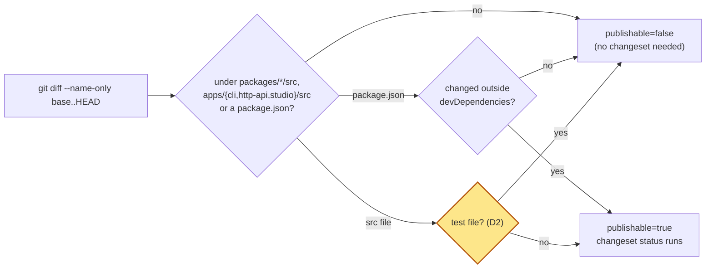

# Spec: test-only changes skip the Changesets check (#560)

## For the owner

A PR whose only changes under a package's `src` are test files passes the Changesets `status` check with no changeset, and the four docs that state the changeset rule say so.

| Decision | Answer | Settled by | Undo |
| --- | --- | --- | --- |
| D1. How a test-only PR gets past the check | Option A: the check ignores test files; no empty-changeset rule (option B) | default D1 (triage) | two-way: revert the workflow edit |
| D2. Which paths count as test files | `*.test.*`, `*.spec.*`, anything under `__tests__/` or `__snapshots__/`, and `test-utils.ts`; nothing else, and never a `package.json` | default D2 (triage) | two-way: drop a pattern from the filter |

The highlighted test-file branch is the only new step; every other branch keeps today's behaviour.

**Risks:** a pattern that is too wide would let a shipped source file through without a changeset. The exempt set matches only test names and folders the package builds already leave out of `dist`, and a self-test of the filter runs inside the `status` check on every PR.

**Done when:** a test-only PR passes `status` with no changeset, a PR with one non-test source file alongside tests still fails without one, and `AGENTS.md`, `CONTRIBUTING.md`, `docs/agents/code-review.md` and `docs/release.md` say test-only changes need no changeset.

**Needs you:** nothing open. D1 and D2 are triage's defaults; veto either in your reply.

Reply: `/answer ok` approves the spec with D1 and D2 · `/answer D2 <change>` changes the exempt set · `/changes <guidance>`

## Problem Statement

The Changesets workflow (`.github/workflows/changesets.yml`) requires a changeset for any change under `packages/*/src` or `apps/{cli,http-api,studio}/src`, and it counts test files as such changes. A test-only PR ships nothing (every package's build excludes its tests from `dist`), yet it fails `pnpm changeset status` unless someone adds a changeset. `AGENTS.md` only says "a changeset for any change to a publishable package", so authors and agents reasonably concluded a test-only change needs none, and their PRs failed CI. In the week to 2026-10-26 that cost 12 test-campaign tickets a send-back each, and each send-back reran a build, docs and review.

## Solution

The workflow's "Detect changes to publishable sources" step stops counting test files. A PR whose publishable-path changes are all test files reports `publishable=false`, so the setup, install and `changeset status` steps are skipped and the `status` check passes. A PR that changes any non-test file under those paths, or a `package.json` outside `devDependencies`, behaves exactly as today. The docs that state the changeset rule say a test-only change needs no changeset.

## User Stories

1. As a contributor adding unit tests to a package, I want the `status` check to pass without a changeset, so that I don't publish an empty or misleading changelog entry for a change hosts never install.
2. As a contributor fixing a flaky test, I want my test-only PR to go green without extra steps, so that the fix merges quickly.
3. As a factory build agent on a test-campaign ticket, I want the docs I read to say test-only changes need no changeset, so that my spec and PR match what CI enforces.
4. As a factory reviewer, I want the review profile to state the same rule CI enforces, so that I don't send back a test-only PR for a missing changeset.
5. As a contributor updating a vitest snapshot under `__snapshots__/`, I want that change treated as test-only, so that a snapshot refresh needs no changeset.
6. As a contributor editing a shared test helper (`test-utils.ts`), I want that change treated as test-only, so that test plumbing needs no changeset.
7. As a contributor who changes a source file and its test in one PR, I want the check to still require a changeset, so that the source change reaches the changelog.
8. As a maintainer, I want a dependency range change hosts install to still require a changeset, so that ADR 0015's rule that published ranges move on purpose stays enforced.
9. As a maintainer, I want the `status` check to keep reporting on every PR, so that it stays usable as a required check in the `main` ruleset.
10. As a maintainer, I want the exempt set written in one place and tested against sample path lists, so that a later edit that widens or breaks it fails CI instead of silently letting shipped sources through.
11. As a maintainer, I want the Version PR skip and the `devDependencies` rule to keep working unchanged, so that the release flow is unaffected.
12. As a contributor reading `CONTRIBUTING.md`, I want "Before Opening a PR" to say which changes need a changeset and which don't, so that I don't guess.
13. As a reader of `docs/release.md`, I want the release flow's description of what `changesets.yml` requires to match its behaviour, so that the release docs stay accurate.

## Implementation Decisions

- **Option A (D1).** The check ignores test files; there is no empty-changeset rule and no doc telling authors to run `pnpm changeset --empty`.
- **The exempt set (D2).** A changed path that already falls under a publishable `src/` (`packages/<pkg>/src/` or `apps/{cli,http-api,studio}/src/`) is exempt when any of these holds:
  - its file name contains `.test.` or `.spec.` (this covers `*.integration.test.ts` and snapshot files such as `prisma.test.ts.snap`);
  - one of its directory segments is `__tests__` or `__snapshots__`;
  - its file name is exactly `test-utils.ts`.
  A `package.json` is never exempt; its existing `devDependencies` rule is unchanged. A path matching none of these keeps today's rule. Patterns match path segments and file names, not substrings of directory names (a directory called `latest.spec-notes/` doesn't make its files exempt only because of `.spec`; only the file's own name is checked for `.test.`/`.spec.`).
- **One filter, in a script.** The classification of changed paths moves out of the workflow's inline loop into a bash script under `scripts/` that reads changed paths on stdin, one per line, and prints the ones that count as publishable source files: those under a publishable `src/` that are not exempt, plus every publishable `package.json` (the workflow then applies `manifest_changed` to those, as today). It exits 0 whether or not anything matched, so the workflow's default `bash -e` shell never fails on a PR that touches no publishable path. The workflow pipes `git diff --name-only "${base}" HEAD` through it in place of today's inline `grep -E`. The Version PR skip, `manifest_changed`, and the outputs and messages of the step keep their current behaviour.
- **A self-test in the same check.** A companion test script feeds the filter fixed sample path lists and fails with the offending path when the output differs from what's expected. The Changesets workflow runs it as a step before "Detect changes to publishable sources", on every PR (it needs only bash and the checkout). A filter that breaks therefore fails the `status` check itself, the gate it protects. The PR's author and reviewers see the red `status` check on the PR, and its step log names each sample path whose result differed and what was expected; the PR can't merge until the filter or the samples are fixed.
- **No workflow-level `paths:`.** The workflow keeps `on: pull_request` with no path filter, so `status` reports on every PR (`docs/agents/code-review.md`: a check that must always report filters with a job-level `if:`).
- **Docs.** One line each, as `AGENTS.md`'s one-line-per-paragraph rule says:
  - `AGENTS.md` Conventions: the changeset line says a change confined to test files (the D2 set) under a package's `src` needs no changeset, and CI doesn't require one.
  - `CONTRIBUTING.md` "Before Opening a PR": the changeset paragraph says the same.
  - `docs/agents/code-review.md`: the "Enforced by tooling" description of the Changesets workflow names the test-file exemption, and the *Docs* lens's "Changelog or changeset rule" says a test-only change needs none.
  - `docs/release.md` step 1 says `changesets.yml` requires a changeset on any PR that changes publishable sources other than tests.
- **No changeset for this PR.** It changes only a workflow, a script under `scripts/` and docs; none of them is a publishable package.

## Testing Decisions

- **Seam:** the filter script's stdin-to-stdout contract, the single seam. It is the highest point that can be run without a GitHub Actions runner or a real PR, and the workflow uses it unchanged, so testing it tests what CI decides.
- **What a good test checks:** only which input paths come out as publishable. It doesn't assert on the script's internals (regexes, case patterns), so the filter can be rewritten without touching the test.
- **Sample lists the test covers:**
  - each D2 pattern under `packages/<pkg>/src/`: `foo.test.ts`, `foo.integration.test.ts`, `foo.spec.ts`, `__tests__/foo.ts`, `__snapshots__/foo.test.ts.snap`, `connector/test-utils.ts` → not printed;
  - the same under each of `apps/cli/src/`, `apps/http-api/src/`, `apps/studio/src/` → not printed;
  - a non-test source file (`packages/core/src/ask.ts`), alone and mixed into a list of test files → printed;
  - a file whose directory, not its name, contains `.test.` or `.spec.` → printed;
  - `packages/<pkg>/package.json` and `apps/cli/package.json` → printed (the workflow's `manifest_changed` decides);
  - paths outside publishable sources (`docs/x.md`, `apps/docs-site/src/x.ts`, `scripts/x.sh`, `packages/core/README.md`) → not printed;
  - an empty input → no output and exit 0.
- **Where it runs:** in the Changesets workflow on every PR, and locally with `bash` on the test script. The repo's vitest runs per package through turbo, and the root has no package that would pick up a test of a root script, so a bash test beside the filter is the right fit.
- **Prior art:** `scripts/test-ai-sdk-floors.sh`, a bash script CI runs as its own step; the inline `manifest_changed` function in `changesets.yml`.
- **End to end:** the PR for this ticket is itself a non-publishable PR, so its own `status` check shows the filter and self-test running in CI. The reviewer checks the step log shows `publishable=false`.

## Out of Scope

- Which non-test paths need a changeset, and `apps/docs-site` (it stays unchecked by CI).
- Changeset bump levels and the release workflow.
- Option B's empty-changeset rule.
- Other test-adjacent paths not in D2, such as fixtures folders under `src/`: they keep needing a changeset until someone adds them to the exempt set.

## Further Notes

- **Ticket coverage**

  | Ticket acceptance criterion | Met by |
  | --- | --- |
  | A PR changing only `*.test.ts` files under `packages/*/src` reports `publishable=false` and passes with no changeset | Implementation Decisions: the exempt set, one filter in a script; Testing: `foo.test.ts` sample |
  | The same for `*.spec.*`, `__tests__/`, `__snapshots__/`, `test-utils.ts`, and the three apps' `src` | Implementation Decisions: the exempt set (D2); Testing: per-pattern and per-app samples |
  | A PR with one non-test file alongside tests still runs `changeset status` and fails without a changeset | Implementation Decisions: the exempt set ("a path matching none of these keeps today's rule"); Testing: mixed list sample |
  | A `package.json` change outside `devDependencies` still requires a changeset | Implementation Decisions: `package.json` is never exempt, `manifest_changed` unchanged; Testing: `package.json` samples |
  | The check is not path-filtered at workflow level and reports on every PR | Implementation Decisions: no workflow-level `paths:` |
  | `AGENTS.md`, `CONTRIBUTING.md` and `docs/agents/code-review.md` say a test-only change needs no changeset, one line per paragraph | Implementation Decisions: Docs (plus `docs/release.md`) |
  | The path logic is exercised by a test or script run against sample path lists | Implementation Decisions: a self-test in the same check; Testing Decisions |
  | (issue) A PR whose only `src` changes are tests passes `status` with no changeset; non-test source still needs one | D1, the exempt set, Testing Decisions |

- The workflow file is a CI and release gate (`docs/agents/code-review.md`, sensitive paths), so review should check the filter against the sample lists above and confirm the Version PR skip and `devDependencies` rule are byte-for-byte unchanged in behaviour.
- Today the repo has 121 `*.test.*` files, one `__snapshots__/` folder (`packages/prisma/src`), and `test-utils.ts` in `packages/postgres/src/connector` and `packages/enrich/src`; no `*.spec.*` files or `__tests__/` folders yet. Every package's `tsconfig.build.json` excludes its tests from the build, and `packages/postgres` and `packages/enrich` also exclude `test-utils.ts`.
- No grilling record exists for this ticket; the decisions are triage's two defaults.
