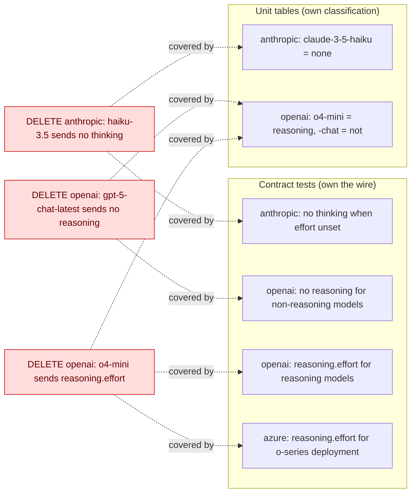

# Spec: #566 Test campaign: ai

## For the owner

This spec deletes three redundant contract tests in `@askdb/ai` that the weekly test campaign marked D, and keeps every test the campaign names as the proof that remains.

| Decision | Answer | Settled by | Undo |
|---|---|---|---|
| Which tests go | Exactly three: Anthropic "sends no thinking block for models without extended thinking", OpenAI "sends reasoning.effort for o-series models", OpenAI "does not send reasoning for gpt-5 -chat variants" | the ticket's campaign plan (#566 body, Retire), checked at triage | two-way |
| Which tests must stay | The unit classification rows and the wire tests listed under Implementation Decisions, including the Azure o-series test and the OpenAI embedding-dimensions test the campaign kept | the ticket's campaign plan (#566 body, Layer plan) | two-way |
| Assertions carried over | None: a unit row already asserts each deleted test's outcome | the ticket's campaign plan (Carry-over assertions) | two-way |
| Production code, seams, changeset | None of them change; no changeset, since only `*.test.ts` under `src` changes | the ticket's Scope and the repo's changeset rule (`AGENTS.md`) | two-way |
| The two possible product bugs (gateway prefix throw, Azure whitespace resource name) | Not in this ticket | the ticket's campaign plan ("none is part of this ticket"), triage's Out of scope | two-way |

Nobody took a default (`decisions_defaulted` is 0), and the grill stage was skipped because no decision was open.

**Risks:** the lane loses one o-series wire test on the OpenAI side; the Azure o-series test, through the same Responses model class, becomes the only one, which is why the campaign keeps it. Deletions only, so a revert restores everything.

**Done when:** the three tests are gone with nothing else in the two files changed, every remaining-proof test exists and passes, and `@askdb/ai`'s tests, `pnpm test:ai-floors` and `pnpm lint` are green.

**Needs you:** nothing. The quick-lane build already did this on the branch (PR #583); the change moved to the standard lane only because contract test files are sensitive paths, not because its size or scope grew.

Reply: `/approve` accepts the spec · `/changes <guidance>`

## Problem Statement

The weekly test campaign audited `@askdb/ai`'s tests at head `5d9878c4` (182 cases, all green) and found three contract tests that can catch nothing another test doesn't. Each one takes a model id whose classification a unit table already owns and sends a request another contract test already sends: either no provider options at all, or a reasoning shape an existing wire test covers. Last week's campaign (#511, applied in PR #524) left these three for a later ticket to stay within budget, not for a stated reason. Redundant tests cost run time, make the suite's structure harder to read (which layer owns what), and have to be kept in step with every SDK change for no added protection.

## Solution

Delete the three tests. The unit tables keep owning model classification, the contract tests keep owning what goes on the wire, and every proof the campaign names for each deleted test stays in place and passes. Nothing else changes: no production code, no other test, no test-only seam, no changeset.

## User Stories

1. As an AskDB maintainer, I want each `@askdb/ai` contract test to guard a request no other test sends, so that a failing contract test points at a wire-level regression and not at a classification row.
2. As an AskDB maintainer, I want model classification (which OpenAI models reason, which Claude models think) asserted in one place, the unit tables, so that a new model id is added to one table and not to several test files.
3. As an AskDB maintainer, I want the request a non-reasoning model sends proven once per provider on the wire, so that the "no options means nothing on the wire" contract has one keeper per provider.
4. As an AskDB maintainer, I want the `reasoning.effort` request shape proven on the wire for OpenAI reasoning models and for an o-series model through the Responses model class, so that dropping the o4-mini OpenAI test loses no wire coverage.
5. As an AskDB maintainer, I want the campaign's kept candidates (the OpenAI embedding-dimensions-alone test and the Azure o-series test) left untouched, so that the reasons recorded for keeping them still hold.
6. As an AskDB maintainer, I want the change confined to two test files, so that it needs no changeset and can't change any published package's behaviour.
7. As a reviewer, I want each deleted test listed with the tests that still prove its outcome, so that I can check the deletion by reading those tests rather than trusting the audit.
8. As a reviewer, I want `pnpm test:ai-floors` run as well as the unit tier, so that the deletion is checked against the oldest supported AI SDK versions the contract files also run under.
9. As the test campaign, I want this ticket to close out the rows #511 deferred, so that next week's campaign starts from a lane with no outstanding D rows.
10. As the factory, I want the two possible product bugs the campaign found kept out of this ticket, so that a test-only change stays test-only and each bug is filed and fixed on its own.

## Implementation Decisions

- **Module:** the `@askdb/ai` package's provider tests only: the Anthropic contract suite and the OpenAI contract suite (real provider SDK, stubbed `fetch`). No module outside those two test files changes.
- **Deleted, each with the blank line after it:**
  - Anthropic contract: "sends no thinking block for models without extended thinking" (`claude-3-5-haiku-20241022`, effort `high`). The provider resolves no options for a model without extended thinking, so the request is the same kind as the "no thinking block when reasoningEffort is unset" test's.
  - OpenAI contract: "sends reasoning.effort for o-series models" (`o4-mini`, effort `high`). The provider resolves the same forced-reasoning options shape as for any reasoning model, so the request is the same kind as the "reasoning.effort for reasoning models" test's.
  - OpenAI contract: "does not send reasoning for gpt-5 -chat variants" (`gpt-5-chat-latest`, effort `high`). The reasoning helper returns no options for `-chat` variants, so the request is the same kind as the "no reasoning block for non-reasoning models" test's.
- **Kept as the remaining proof** (none of these is edited):
  - Anthropic unit table: `claude-3-5-haiku-20241022` and the other `none` rows.
  - Anthropic contract: "sends the model id and no thinking block when reasoningEffort is unset".
  - OpenAI unit table: the reasoning rows including `o4-mini-2025-04-16`, and the `-chat` rows (`gpt-5-chat`, `gpt-5-chat-latest`, `gpt-5.1-chat-latest`) as non-reasoning.
  - OpenAI contract: "sends the model id and no reasoning block for non-reasoning models" and "sends reasoning.effort for reasoning models when reasoningEffort is set".
  - Azure contract: "sends reasoning.effort for reasoning-model deployments" (o-series through the same Responses model class).
- **Kept candidates, left alone:** OpenAI contract "forwards embedding dimensions alone without a user field" (kept for the mutation-based reason in 3befe2ec) and the Azure o-series test above.
- **Carry-over assertions:** none.
- **Test-only production seams:** none to remove; the campaign checked each exported helper has a production caller.
- **Changeset:** none. The change is confined to `*.test.ts` under a package's `src`, which `AGENTS.md` and the Changesets CI check (#560) exempt.
- **State of the branch:** the quick-lane build already committed exactly this deletion (16 lines removed across the two files) and opened PR #583. The lane moved to standard on the sensitive-path tripwire, not on size. The build stage checks that commit against this spec rather than redoing it.

## Testing Decisions

- **No new tests.** The change removes tests; the proof that remains is existing tests, listed above. A good test here is one that asserts an external outcome (what the provider sends on the wire, or how a model id is classified) that no other test asserts; the deleted three failed that bar.
- **How the deletion is checked:**
  - by reading the diff: only the three `it` blocks and the blank line after each are removed, in the two contract files, and nothing else in those files changes;
  - by name: each remaining-proof test listed under Implementation Decisions still exists;
  - by running: `@askdb/ai`'s tests are green (182 cases at the campaign's head, 179 after the deletion), `pnpm test:ai-floors` passes (it runs every test file in the lane against the AI SDK floor versions), and `pnpm lint` passes.
- **Repo PR checks:** `pnpm smoke:install` and `pnpm preflight` before the PR leaves draft, as `AGENTS.md` asks of every PR.
- **Prior art:** PR #524 (#511) removed the registry-inventory and Azure-classification duplicates from the same lane by the same rule: unit tables own classification and option shape, contract tests own the wire, registry tests own selection and messages.

## Out of Scope

- **The two possible product bugs** the campaign reproduced: `gatewayProvider.resolveProviderOptions` throwing for a model id without an upstream prefix when no effort is set, and Azure accepting a whitespace-only resource name. Neither fails at baseline; the campaign asks for each to be filed separately if it should be fixed.
- **The campaign's kept candidates:** the OpenAI embedding-dimensions-alone test and the Azure o-series test.
- **Any other test file in the lane,** and any production code in `@askdb/ai`.
- **Docs:** no public API, package output or user-facing behaviour changes, so `apps/docs-site` needs nothing.

## Further Notes

- No failure path is added: the change deletes tests and adds no error, throw, refusal or escalation.
- Campaign marks for the lane: R 115 · F 0 · C 0 · D 3. With F and C at zero, the issue's F, C and seam acceptance criteria are met by there being none to do.

## Ticket coverage

| Ticket item (issue's Acceptance criteria, and triage's) | Met by |
|---|---|
| "Each `F` row below is repaired…" | Further Notes: the campaign lists no F rows (F 0) |
| "Each `C` row below is consolidated into its named keeper…" | Further Notes: no C rows (C 0); Implementation Decisions, Carry-over assertions: none |
| "Each `D` row below is deleted, and the proof that remains (named in its evidence) still exists and passes." | Implementation Decisions, Deleted and Kept as the remaining proof; Testing Decisions, How the deletion is checked |
| "Each test-only production seam the layer plan unlocks is removed (none, if the plan says none)." | Implementation Decisions, Test-only production seams: none |
| "The subsystem's tests are green with `pnpm test`, and `pnpm lint` passes." | Testing Decisions, by running |
| Row: anthropic.contract.test.ts:82 — sends no thinking block for models without extended thinking (D) | Implementation Decisions, Deleted (first item) |
| Row: openai.contract.test.ts:88 — sends reasoning.effort for o-series models (D) | Implementation Decisions, Deleted (second item) |
| Row: openai.contract.test.ts:105 — does not send reasoning for gpt-5 -chat variants (D) | Implementation Decisions, Deleted (third item) |
| Triage: "The three listed tests are deleted, and no other test in either file is removed or edited." | Implementation Decisions, Deleted; Testing Decisions, by reading the diff |
| Triage: "Each remaining-proof test listed above still exists and passes." | Implementation Decisions, Kept as the remaining proof; Testing Decisions, by name and by running |
| Triage: "`pnpm test` is green for `packages/ai`, `pnpm test:ai-floors` passes, and `pnpm lint` passes." | Testing Decisions, by running |
| Triage: "No production code changes, no test-only seam added or removed, and no changeset (test-only change under `src`)." | Implementation Decisions, Module, Test-only production seams and Changeset |
