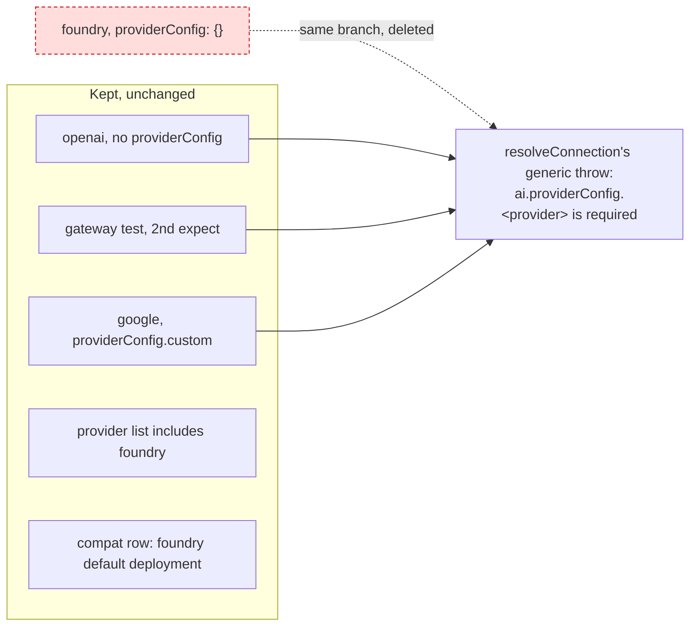

# Spec: apply the client-config test campaign plan (#567)

## For the owner

This spec deletes one redundant test from `@askdb/config`'s suite: "throws a clear error when foundry provider has an empty providerConfig". It reaches the same branch and the same throw as tests the suite keeps. No production code changes, and no changeset is added.

| Decision | Answer | Settled by | Undo |
| --- | --- | --- | --- |
| 1. What the PR changes | Delete the one `D` row (the foundry empty-`providerConfig` test). There are no `F` or `C` rows, and no other test changes | The campaign plan in the issue body, confirmed at triage with no open decisions | Two-way: revert the PR |
| 2. Which tests carry the contract afterwards | The openai test with no `providerConfig`, the gateway test's second `expect`, and the `providerConfig.custom` variant test. Foundry's built-in status stays pinned by the provider-list test and the "foundry with the default deployment" compatibility row | Campaign plan, keepers and evidence; triage Agent Brief | Two-way |
| 3. Test-only production seams | None to remove. `setAskDbRuntimeForTests` and `resetAskDbRuntimeForTests` stay (used by six test files outside this subsystem) | Campaign plan, "Test-only production seams unlocked: none" | Two-way |
| 4. Changeset | None. `AGENTS.md` says a test-only change under a package's `src` needs none, and #560 made the Changesets check skip such changes | The repo's own rule (`AGENTS.md`, #560), cited at triage | Two-way |
| 5. The two follow-ups in the issue (unused `makeConfig` params; no test for default-schema precedence) | Out of scope. Not done or filed here | Campaign plan, "Not part of this ticket"; triage Out of scope | Two-way |

**Risks:** the deleted test is the only one passing `providerConfig: {}` rather than leaving `providerConfig` out. The connection reader treats both the same (`config.ai.providerConfig ?? {}`, then a loop over no entries), so no keeper loses an input. `packages/config/src/**` is a sensitive path, which is why this ticket runs in the standard lane.

**Done when:** the foundry test is gone and nothing else in `config.test.ts` changes, the five kept proofs exist unchanged and pass, `@askdb/config`'s count drops by exactly one test, no production file or changeset changes, and `pnpm test` and `pnpm lint` pass.

**Needs you:** nothing. No decision was left open and none was taken as a default.

Reply `approve`, or `/changes` with what to change.

## Problem Statement

The weekly test campaign audited the `client-config` subsystem's tests (`@askdb/client`, `@askdb/config`, `@askdb/connectors`) read-only at `5d9878c4` and marked 1 of 127 declarations. The `flattenAskDbConfig` suite has a foundry test that expects `ai.providerConfig.foundry is required` when `providerConfig` is empty. When the per-provider tests were written (#116), each provider had its own branch in config normalization. Since those branches were replaced by one generic `resolveConnection`, the provider id only fills in the error message, so the foundry test runs the same code and expects the same throw as the openai test above it. Maintainers reading the suite see two tests for one contract.

## Solution

The suite owns the contract "a built-in AI provider with no connection fails load with a clear `ai.providerConfig.<provider> is required` error" through the tests it already has: the openai test with no `providerConfig`, the gateway test's second `expect`, and the `providerConfig.custom` variant test. The foundry duplicate goes. Two other tests pin foundry's built-in status, which is the only thing that makes foundry throw rather than resolve to no connection: the provider-list test and the compatibility row "foundry with the default deployment".

## User Stories

1. As a maintainer of `@askdb/config`, I want one test per contract in the `flattenAskDbConfig` suite, so that the suite's size reflects the contracts it proves.
2. As a maintainer, I want the missing-connection error owned by the openai test with no `providerConfig`, so that the generic `resolveConnection` throw has one named keeper.
3. As a maintainer, I want the gateway test's second `expect` and the `providerConfig.custom` variant test kept, so that the same throw stays proven for a second provider and for the legacy `custom` key.
4. As a maintainer, I want foundry's membership in the built-in provider list kept under test, so that removing foundry from that list still fails a test after the duplicate goes.
5. As a maintainer, I want foundry's happy path kept by the compatibility row "foundry with the default deployment", so that foundry config still has a test end to end.
6. As a maintainer, I want an empty `providerConfig: {}` and an absent `providerConfig` confirmed to reach the same code, so that deleting the only `{}` test loses no input.
7. As a maintainer, I want no other test in `config.test.ts` touched, so that the diff is exactly the one ledger row.
8. As a reviewer, I want no production file, export or test-only seam changed, so that the PR is reviewable as test-only.
9. As a reviewer, I want the removal traceable to its ledger row and its keepers, so that I can check the evidence against the code.
10. As a release manager, I want no changeset, so that the PR follows `AGENTS.md`'s rule for test-only changes and releases nothing.
11. As a maintainer, I want `setAskDbRuntimeForTests` and `resetAskDbRuntimeForTests` left in place, so that the six test files outside this subsystem that use them keep working.

## Implementation Decisions

Test names below are as they read at `5d9878c4`. The issue's line numbers match that commit, but build finds tests by name.

- **Delete the `D` row (decision 1).** In the `flattenAskDbConfig` describe of `@askdb/config`'s test suite, remove the whole `it` block "throws a clear error when foundry provider has an empty providerConfig" (about 13 lines, directly after the `providerConfig.custom` variant test). Remove the block and one of the blank lines around it. Nothing else in the file changes.
- **Keepers stay unchanged (decision 2).**
  - "throws a clear error when openai provider has no providerConfig": the same branch and the same message shape.
  - "defaults the gateway model to openai/gpt-4o-mini and requires its branch": its second `expect` hits the same throw for gateway.
  - "throws a clear error when google provider has providerConfig.custom instead of providerConfig.google": the legacy `custom` variant of the same throw.
  - The `ASKDB_AI_PROVIDERS` describe's "lists every first-party provider id flattenAskDbConfig handles, including anthropic and gateway": pins foundry in the list that the built-in check reads.
  - The `compatibility` table's row "foundry with the default deployment": foundry's happy path.
- **Why the foundry input adds nothing.** The connection reader iterates `config.ai.providerConfig ?? {}`, so `{}` and an absent `providerConfig` both give an empty connection table. `resolveConnection` then reaches its built-in check and its single generic throw, where only the provider id differs. The ledger row's evidence traces this to 665f026a, which replaced the per-provider `requireProviderBranch` calls.
- **Leftovers.** The deleted block uses only `flattenAskDbConfig`, `minimalConfig` and `AskDbConfig`, which other tests in the file still use, so no import or helper becomes unused.
- **No seams (decision 3).** No production export is added or removed.
- **No changeset (decision 4).** The change is confined to a `*.test.*` file under `packages/config/src`, which `AGENTS.md` exempts and the Changesets check skips since #560.

## Testing Decisions

- A good test here checks `@askdb/config`'s public functions (`flattenAskDbConfig` and the exported provider list) and not normalization internals. This ticket adds no test and no seam. It removes one test whose input the keepers already cover.
- Confirm on the branch that the five keepers above still exist, unchanged, and pass.
- Expected counts: `@askdb/config` drops by exactly one test (143 to 142 at the campaign's head). `@askdb/client` and `@askdb/connectors` are unchanged.
- Confirm the diff touches only `packages/config/src/config.test.ts` and only deletes lines.
- Run `@askdb/config`'s suite, then `pnpm test` and `pnpm lint` at the root.
- Prior art: #512 (applied by #527) used the same approach of deleting a test and citing its keeper in this subsystem.

## Out of Scope

- Dropping `makeConfig`'s unused `schemaPath`, `schemaJson`, `envSchemaPath` and `envSchemaJson` parameters in `@askdb/client`'s facade tests, and adding a test for the facade's JSON-over-path default-schema precedence. These are the maintainer's call, and this ticket doesn't file them.
- The overlaps the plan kept: the azure/foundry `it.each` and the `ai.language.reasoning` test overlap compatibility rows that use deprecated shapes, so they stay as the owners of the current shapes until 1.0.
- Removing `setAskDbRuntimeForTests` / `resetAskDbRuntimeForTests`.
- Any production code change in `@askdb/config`, `@askdb/client` or `@askdb/connectors`, and any test not named in the ledger row.

## Ticket coverage

| Done when (acceptance criterion) | Met by |
| --- | --- |
| Issue: each `F` row repaired (none) | Decision 1: there are no `F` rows |
| Issue: each `C` row consolidated (none) | Decision 1: there are no `C` rows |
| Issue: each `D` row deleted, remaining proof still exists and passes | Delete the `D` row; Keepers stay unchanged; Testing Decisions (keeper check) |
| Issue: each test-only seam removed (none) | No seams; decision 3 |
| Issue: `pnpm test` green, `pnpm lint` passes | Testing Decisions |
| Triage: the foundry test no longer exists, and no other test in the file changes | Delete the `D` row; Testing Decisions (diff check) |
| Triage: the three keeper tests still exist and pass | Keepers stay unchanged; decision 2 |
| Triage: the two foundry-status proofs still exist and pass | Keepers stay unchanged; decision 2 |
| Triage: `pnpm test` and `pnpm lint` pass | Testing Decisions |
| Triage: no changeset is added | No changeset; decision 4 |

## Further Notes

- The ticket passed the grill stage with no grilling record: triage listed no open decisions and took no defaults.
- The issue's "Scope" line mentions #512's empty changeset. That was needed before #560, and decision 4 replaces it.
