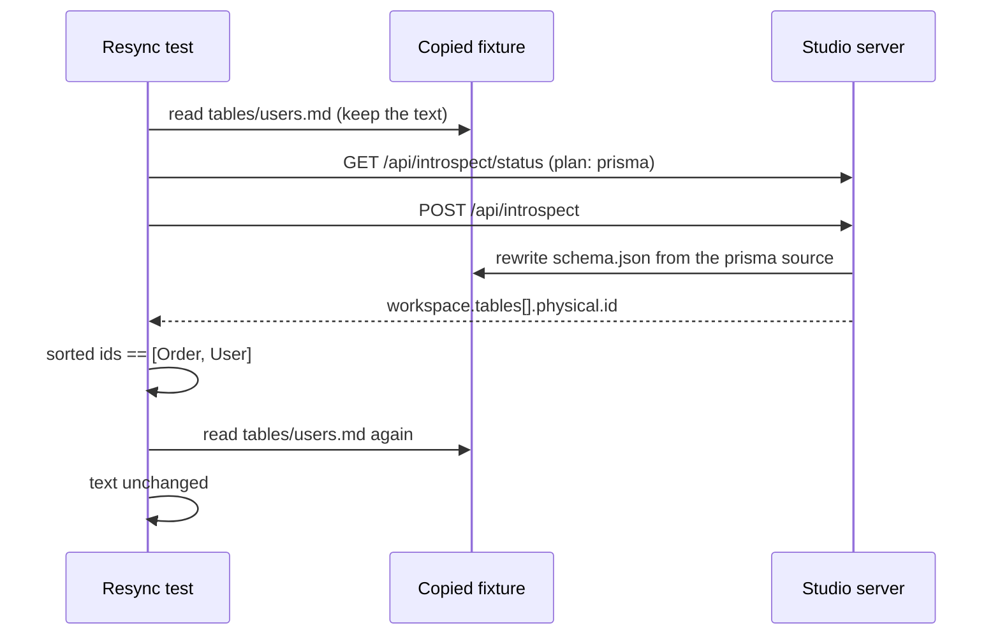

# Spec: apply the studio test campaign's plan (#575)

## For the owner

This spec repairs two Studio server tests whose assertions can't fail today, so each one fails for the regression its name promises; it is one test-only PR to `apps/studio/src/server.test.ts`.

| Decision | Answer | Settled by | Undo |
| --- | --- | --- | --- |
| 1. Setup-status test: what `schemaPathRelative` must be | Exactly the schema dir (the absolute path), in place of the type check | The campaign's ledger in the issue body, confirmed at triage | Two-way: revert the PR |
| 2. Resync test: what proves the physical layer was regenerated | The sorted table ids equal `["table:public.Order", "table:public.User"]`, in place of the two `> 0` counts | The campaign's ledger, confirmed at triage | Two-way |
| 3. Resync test: what proves enrichment survived | `tables/users.md` is byte-identical before and after the resync, in place of "the file exists" | The campaign's ledger, confirmed at triage | Two-way |
| 4. Scope | Test-only, one file, no production change, no seam removed, no changeset | The campaign's plan and triage | Two-way |

```text
apps/studio/src/server.test.ts
  setup-status test ── typeof schemaPathRelative "string" ───▶ schemaPathRelative === schemaDir      [F repaired]
  resync test ──────── tables > 0, workspace.tables > 0 ────▶ sorted physical ids === [Order, User]  [F repaired]
               ──────── existsSync(users.md) ───────────────▶ users.md bytes unchanged by resync     [F repaired]
```

**Risks:** the first repair relies on the fixture dir sitting outside the test's cwd (it is a `mkdtemp` under the OS tmpdir); a fixture moved under `apps/studio` would change the expected value. No production behavior changes.

**Done when:** both rows are repaired and each repaired assertion fails under its named mutation; `pnpm test` and `pnpm lint` pass with no production file and no changeset.

**Needs you:** nothing.

Reply `approve`, or `/changes` with what to change.

## Problem Statement

The weekly test campaign read the Studio subsystem's tests and found two whose assertions pass whatever the server does. `GET /api/setup/status reports not needed on a ready workspace` checks only that `workspace.schemaPathRelative` is a string, which the field's type already guarantees. That value is the schema path the Playground's "Get the code" snippet embeds, and no other test checks it, so a regression that returned a `../../..` traversal would ship unseen. `POST /api/introspect resyncs from a prisma source and preserves enrichment files` checks only that table counts are above zero and that `tables/users.md` exists. All three are true of the copied fixture before the resync runs, so the test would pass if the resync did nothing, or if it blanked the enrichment markdown. It is the only HTTP test of the resync over an existing artifact, and no test anywhere checks that `tables/*.md` content survives re-introspection.

## Solution

Each test keeps its name, setup and contract, and its weak assertions are replaced by ones that can fail. The setup-status test asserts the exact `schemaPathRelative` value Studio must return for a schema dir outside its cwd. The resync test captures the enrichment markdown before the resync and asserts it is byte-identical after, and asserts that the workspace's tables now carry the ids the prisma source produces, which differ from the fixture's. No Studio response, server code or test-only seam changes.

## User Stories

1. As a maintainer, I want the setup-status test to fail if `schemaPathRelative` stops being the schema dir for a dir outside Studio's cwd, so that a traversal path can't reach the "Get the code" snippet unseen.
2. As a maintainer, I want the setup-status test to keep its `needed: false` and `reason: null` assertions, so that the setup-status contract it already proves stays proven.
3. As a maintainer, I want the setup-status test to keep its `dialect` assertion, so that the workspace response's dialect stays checked.
4. As a maintainer, I want the resync test to fail if the resync leaves the fixture's physical layer in place, so that a resync that silently does nothing is caught.
5. As a maintainer, I want the resync test to assert the exact set of regenerated table ids, so that a resync from the wrong source, or one that drops or adds a table, is caught.
6. As a maintainer, I want the table ids compared as a sorted list, so that the test doesn't depend on the order Studio lists tables in.
7. As a maintainer, I want the resync test to fail if the resync rewrites, blanks or deletes `tables/users.md`, so that the promise that enrichment survives re-introspection is proven, not assumed.
8. As a maintainer, I want the enrichment captured after the fixture is copied and before the resync request, so that the comparison is against what the user had, not against a file the server already touched.
9. As a maintainer, I want the resync test to keep its status-plan and `ok`/`engine` assertions, so that the prisma plan and run result stay checked.
10. As a reviewer, I want each repaired assertion shown to fail under its named mutation, so that I can trust the repair isn't another assertion that can't fail.
11. As a contributor, I want `pnpm test` and `pnpm lint` green after the change, so that the repair breaks nothing.
12. As a host app developer, I want no Studio response or behavior to change, so that this test repair needs nothing from me.

## Implementation Decisions

- **Test-only, one file (decision 4).** Only the Studio server tests change. No production file changes. The test-only seams (`setStudioClientDirForTests`, `setStudioPgvectorStoreFactoryForTests`, `setSetupInstallerForTests`) stay: each is still used by a kept test. No changeset: a change confined to test files under a package's `src` needs none, and CI's Changesets check skips it since #560.
- **Setup-status repair (decision 1).** In `GET /api/setup/status reports not needed on a ready workspace`, the type check on `workspace.schemaPathRelative` becomes an equality check against the schema dir the test passed to `createStudioServer`. The test copies the fixture into a fresh temp dir under the OS tmpdir, which is never under Studio's cwd (`apps/studio` under vitest), so Studio's outside-cwd branch returns the schema dir unchanged. The `needed`, `reason` and `dialect` assertions stay as they are.
- **Resync repair, regenerated ids (decision 2).** In `POST /api/introspect resyncs from a prisma source and preserves enrichment files`, the two `> 0` count assertions (on the run's `tables` and on `workspace.tables.length`) are replaced by one assertion: the response's `workspace.tables`, mapped to each table's `physical.id` and sorted, equals `["table:public.Order", "table:public.User"]`. The copied fixture's ids are `table:public.users` and `table:public.orders`; the prisma fixture (`packages/prisma/test-fixtures/simple`) has models `User` and `Order`. So the assertion holds only when the physical layer was rebuilt from the prisma source. The `ok` and `engine` assertions, and the status-plan assertions before the resync, stay.
- **Resync repair, enrichment survives (decision 3).** The test reads `tables/users.md` from the copied fixture after its existing existence check and before the resync request, and keeps the text. After the resync, the existence check on that file becomes an assertion that its content equals the captured text, byte for byte. The pre-resync existence check stays, so a fixture without the file fails loudly at setup. The comment above the final assertion stays true as written.



## Testing Decisions

- **One seam, the existing one.** Both tests drive Studio over HTTP: build the server with `createStudioServer`, listen, and read `GET /api/workspace` or `POST /api/introspect`; the enrichment check reads the fixture's file on disk, which is what the user keeps. No new seam, helper or fixture is added.
- **Good tests here** assert what Studio returns or leaves on disk, not how it computes it: the path value in the workspace response, the table ids in the resync response, and the markdown bytes in the schema dir.
- **Each repaired assertion is gated with `factory-test-audit`, and shown to fail once under its mutation**, then the mutation is reverted:
  - make Studio's schema-path helper return the relative path in its outside-cwd branch: the setup-status test fails;
  - make the resync skip the introspection run (or point it at the fixture's own artifact) so the ids stay `users`/`orders`: the resync test fails on the ids;
  - make the resync write to `tables/users.md`: the resync test fails on the markdown.
  The PR body says which mutations were run and that each failed.
- **Prior art:** the same file's tests already read fixture files with `readFileSync` and compare response fields with `toEqual`; the guided-setup test uses the same prisma fixture.

## Out of Scope

- Any production file, including the dead exports in Studio's execute registry (`wrapWithRowLimit`, `DEFAULT_EXECUTE_TIMEOUT_MS`, `DEFAULT_EXECUTE_MAX_ROWS`): they are dead exports, not test seams, and the campaign noted them only.
- New tests for the coverage gaps the campaign noted: `cache-control: no-store`, `content-security-policy: frame-ancestors 'none'`, and `/assets/` path containment.
- Other Studio tests, the pgvector integration test, and the test-only seams.
- Asserting the run's `tables` count by value: the sorted-ids assertion already pins the table set, so the ledger drops the count rather than restating it.

## Further Notes

- The campaign checked both repairs read-only against the built server at head `5d9878c4`: `schemaPathRelative === schemaDir`, and after the resync the ids are exactly the two above and `users.md` is byte-identical. Triage re-verified the code paths behind both.
- The ticket has no grilling record: triage found no open decisions and no defaults, so every decision above comes from the campaign's ledger as the issue states it.
- Expected size: about 6 changed lines in one file.

## Ticket coverage

| Ticket item | Met by |
| --- | --- |
| Each `F` row repaired: the test keeps its contract and its assertion can fail | Implementation Decisions, the three repair items; Testing Decisions, mutations |
| Each `C` row consolidated into its keeper | None in the plan (`C 0`); nothing to do |
| Each `D` row deleted, its remaining proof still passing | None in the plan (`D 0`); nothing to do |
| Each test-only seam the plan unlocks removed | None unlocked; Implementation Decisions, "Test-only, one file" |
| `pnpm test` and `pnpm lint` pass | Done when; Testing Decisions |
| Row `server.test.ts:1001` setup status (F) | "Setup-status repair"; decision 1 |
| Row `server.test.ts:1073` resync from prisma (F) | "Resync repair, regenerated ids" and "Resync repair, enrichment survives"; decisions 2 and 3 |
| Brief: setup-status test keeps `needed`/`reason` and asserts the schema dir | "Setup-status repair" |
| Brief: resync test reads `users.md` before and asserts it unchanged after | "Resync repair, enrichment survives" |
| Brief: sorted ids in place of the two `> 0` counts | "Resync repair, regenerated ids" |
| Brief: each repaired assertion fails when mutated | Testing Decisions, mutations |
| Brief: no changeset | "Test-only, one file" |
