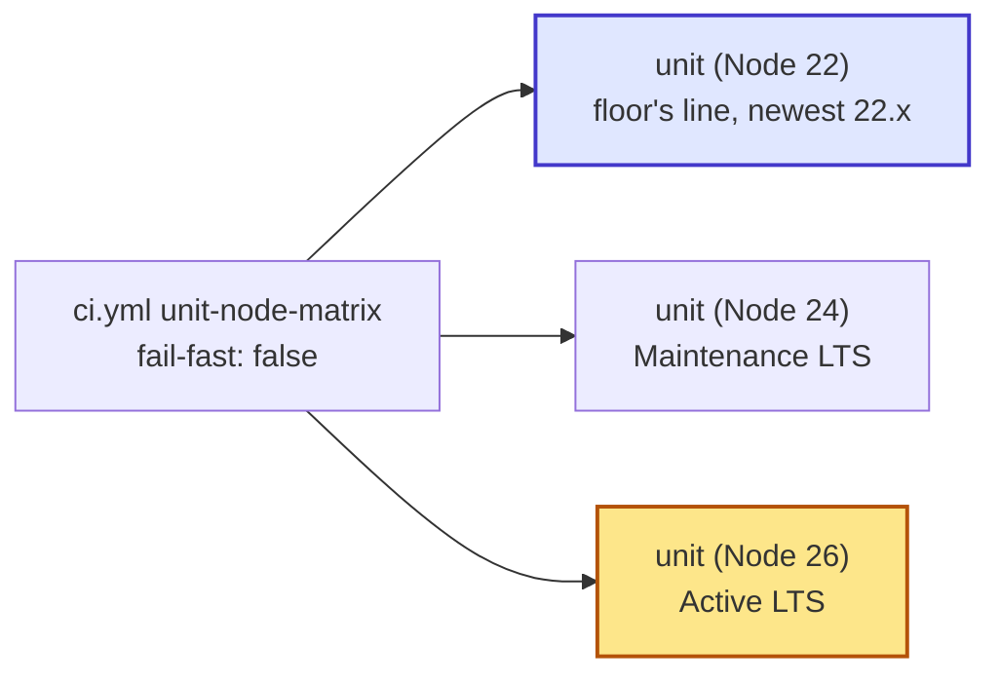

# Spec: add Node 26 to the unit matrix (#589)

## For the owner

CI's `unit-node-matrix` runs the unit suites on Node 22, 24 and 26, each by major line, and the workflow comment and the two docs that name the matrix say Node 22, 24 and 26; the supported range (`>=22.23.4`) does not change.

| Decision | Answer | Settled by | Undo |
| --- | --- | --- | --- |
| 1. What the matrix runs | `["22", "24", "26"]`: add `"26"`, keep 24, and write the Node 22 entry as the major `"22"` instead of `"22.23.4"` | owner, issue #589 body (Step 1, STOP), and the change request on spec v1 (T3 ticket thread, quoted on the issue) | two-way: edit the list |
| 2. The published range | `engines.node` stays `>=22.23.4` in every package | owner, issue #589 body (STOP) | two-way |
| 3. If `unit (Node 26)` fails | File what broke as its own issue and escalate the ticket; never drop 22 or 24 or edit the matrix to go green | owner, issue #589 body (Step 3) | two-way |
| 4. Docs to update | The `ci.yml` comment above the job, `CONTRIBUTING.md` and `docs/agents/code-review.md` say Node 22, 24 and 26 | owner, issue #589 body (Step 2 and Why), and the change request on spec v1 | two-way |

The yellow job is new; the blue one was `unit (Node 22.23.4)` and is now `unit (Node 22)`. Every other CI job stays as it is.

**Risks:** Node 26 may break the build or a unit suite, most likely the native `better-sqlite3` dependency (no prebuild yet for a new Node major). Only CI can tell; decision 3 says what happens then.
With `"22"` the job runs the newest Node 22 release, so CI no longer runs the exact floor 22.23.4; a break that only affects 22.23.4 itself would go unseen.
This branch predates the 22.23.4 floor, so build merges `origin/main` first or the doc edits would put 22.14 back.

**Done when:** `unit (Node 22)`, `unit (Node 24)` and `unit (Node 26)` are green on the PR; the workflow comment, `CONTRIBUTING.md` and `docs/agents/code-review.md` say the unit suites run on Node 22, 24 and 26 and name no 22.14; no `engines.node` changes.

**Needs you:** nothing open. There are no defaults; every decision comes from the issue body you wrote and your change request on v1.

Reply: `/answer ok` approves the spec · `/changes <guidance>`

## Problem Statement

AskDB's published libraries declare `engines.node >=22.23.4`, which admits Node 26. Node 26 became Active LTS on 2026-10-28, and Node 24 moved to Maintenance LTS. CI's `unit-node-matrix` exists to prove the supported Node lines build and pass the unit suites, but it runs only 22.23.4 and 24, so the version most new hosts (and Lambda's `nodejs26.x` preview) will run is admitted by the range yet proved by nothing. A host on Node 26 that hits a build or runtime break would find it before AskDB does.

## Solution

The matrix gains a third job, `unit (Node 26)`, beside Node 22 and Node 24, and the Node 22 entry becomes the major `"22"`, so its job is `unit (Node 22)` and runs the newest 22.x. Each job still does a clean build and runs the unit suites, and `fail-fast: false` keeps one version's failure from cancelling the others. The comment above the job says it runs Node 22, 24 and 26. `CONTRIBUTING.md` and the review profile (`docs/agents/code-review.md`) say CI runs the unit suites on Node 22, 24 and 26. Nothing about who AskDB supports changes: hosts on 22 and 24 stay supported until those lines reach EOL. If Node 26 fails, the failure is filed as its own issue and the PR waits on it; the matrix is not edited to hide it.

## User Stories

1. As a host developer on Node 26, I want AskDB's CI to build and run its unit suites on Node 26, so that I can rely on the published range admitting 26 meaning 26 works.
2. As a host developer on Node 22 or 24, I want those versions to stay in the matrix, so that adding 26 doesn't quietly drop proof for the version I run.
3. As a host developer deploying to Lambda's `nodejs26.x`, I want Node 26 proved before that runtime leaves preview, so that I can move to it without testing AskDB myself.
4. As a maintainer, I want a Node 26 break to surface as a red `unit (Node 26)` job on a PR, so that I learn of it from CI rather than from a host's bug report.
5. As a maintainer, I want one version's failure not to cancel the other jobs, so that a Node 26 break still shows whether 22 and 24 pass.
6. As a maintainer, I want a Node 26 failure filed as its own issue with the failing step and log excerpt, so that the fix is tracked and not lost inside this CI change.
7. As a maintainer, I want the supported range left alone in this change, so that adding proof for 26 is never mistaken for a floor change.
8. As a contributor reading `CONTRIBUTING.md`, I want it to name the Node versions CI runs, so that I know which versions to check locally when I touch native or version-sensitive code.
9. As a reviewer following `docs/agents/code-review.md`, I want its list of CI workflows to name the versions `unit-node-matrix` runs, so that I can tell whether a PR's checks cover the versions its change affects.
10. As an agent reading the workflow, I want the comment above `unit-node-matrix` to name the three lines it runs, so that I don't remove the previous LTS thinking it redundant.
11. As a maintainer, I want the docs edits to start from the 22.23.4 floor on `main`, so that they don't put the old 22.14 floor back.
12. As a maintainer, I want no changeset on this PR, so that a CI-only change doesn't produce a release.

## Implementation Decisions

- **Matrix.** The `unit-node-matrix` job's `matrix.node` list becomes `["22", "24", "26"]`. All three are major-only, so `actions/setup-node` installs the newest release of each line; the exact floor 22.23.4 is no longer what the Node 22 job runs (owner's change request on v1). The job name template `unit (Node ${{ matrix.node }})` and the check run title derived from the matrix yield `unit (Node 22)`, `unit (Node 24)` and `unit (Node 26)`; neither template needs an edit. `fail-fast: false` stays.
- **Workflow comment.** The comment above the job says the unit suites build and pass on Node 22, 24 and 26 (today it says "proves the floor and the current LTS"). Its first line, that the published libraries declare `engines.node >=22.23.4`, stays, as does the rest (clean build, integration suites skip here, the `test` job owns integration on Node 22).
- **Docs.** The sentence in `CONTRIBUTING.md` ("CI builds and runs the unit suites on Node 22.23.4 and 24") and the "CI workflows that run tests" entry in `docs/agents/code-review.md` (`unit-node-matrix` on Node 22.23.4 and 24) say Node 22, 24 and 26. The floor statements beside them ("Use Node 22.23.4 or newer", `>=22.23.4`, and line 38 of the review profile) stay, since the floor doesn't change. Triage searched the ADRs, `docs/architecture.md`, `docs/contracts`, the docs site, `scripts` and the other workflows; nothing else names the matrix. `AGENTS.md` and `README.md` name only the floor, which doesn't change.
- **Base.** The branch was cut five commits behind `origin/main`, before the floor rose to 22.23.4 (#586). Build merges `origin/main` into the branch before editing, so the edits land on the 22.23.4 text.
- **Unchanged.** `engines.node` in every package; the `test`, `preflight` and `consumer-lab` jobs' Node version (they stay on Node 22); the Node versions in other workflows.
- **On a Node 26 failure.** The PR stays draft. Build files one issue naming the failing step with a log excerpt, and escalates the ticket. It does not remove 26, drop 22 or 24, mark the job `continue-on-error`, or work around the break in this ticket.
- **No changeset.** No publishable package changes.

## Testing Decisions

- The test is CI itself: the three jobs `unit (Node 22)`, `unit (Node 24)` and `unit (Node 26)` on the PR are the acceptance check. There is no unit test to write; a test that parsed `ci.yml` for the matrix list would only restate the edit.
- A good check here proves behaviour on the real runtime: each job runs a clean build (no Turbo cache) and `pnpm test` without DB URLs, so the native `better-sqlite3` build and every unit suite run on each version.
- Local check before pushing: `pnpm smoke:install` and `pnpm preflight` per `AGENTS.md`. No Node 26 is installed locally, so only CI proves 26.
- Docs check: `grep` for `22.14` in the three edited files returns nothing, and each says the unit suites run on Node 22, 24 and 26.
- Prior art: the floor-raise PR (#586) changed the same matrix line and the same two doc sentences.

## Ticket coverage

| Done when (issue #589 and triage criteria) | Met by |
| --- | --- |
| `unit-node-matrix` lists `"26"` alongside the floor and `"24"` (Step 1) | Decision 1; Implementation Decisions, Matrix |
| `CONTRIBUTING.md` and `docs/agents/code-review.md` name the three versions (Step 2; Node 22, 24 and 26 per the change request on v1) | Decision 4; Implementation Decisions, Docs |
| The workflow comment names Node 22, 24 and 26, and no stale 22.14 remains | Decision 4; Implementation Decisions, Workflow comment and Base |
| `unit (Node 26)` green with the Node 22 job (now `unit (Node 22)`) and `unit (Node 24)` (Verification) | Decision 1; Testing Decisions |
| `engines.node` unchanged; neither 22 nor 24 leaves the matrix (STOP) | Decisions 1 and 2; Implementation Decisions, Unchanged |
| If 26 fails, file what broke; the matrix is not edited to hide it (Step 3) | Decision 3; Implementation Decisions, On a Node 26 failure |

## Out of Scope

- Raising `engines.node` or dropping Node 22 or 24 (the issue's STOP).
- Moving the `test`, `preflight` or `consumer-lab` jobs off Node 22.
- Fixing a Node 26 incompatibility in this ticket; it gets its own issue.
- Pinning any matrix entry to a patch version, including the floor 22.23.4.
- A changeset.

## Further Notes

- Node lines and EOL dates as the issue states them: 22 (EOL 2027-04-30), 24 Maintenance LTS (EOL 2028-04-30), 26 Active LTS since 2026-10-28 (EOL 2029-04-30).
- `.github/workflows/ci.yml` is an always-sensitive path, which is why this tiny change runs in the standard lane.
